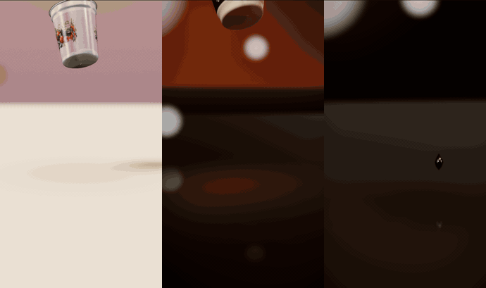
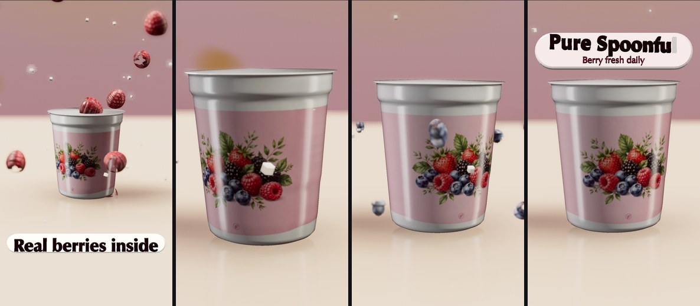
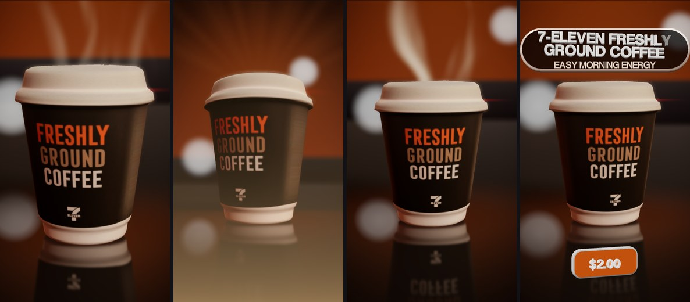
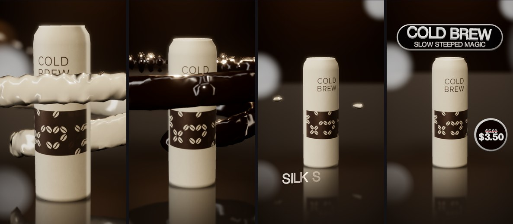
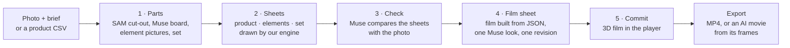
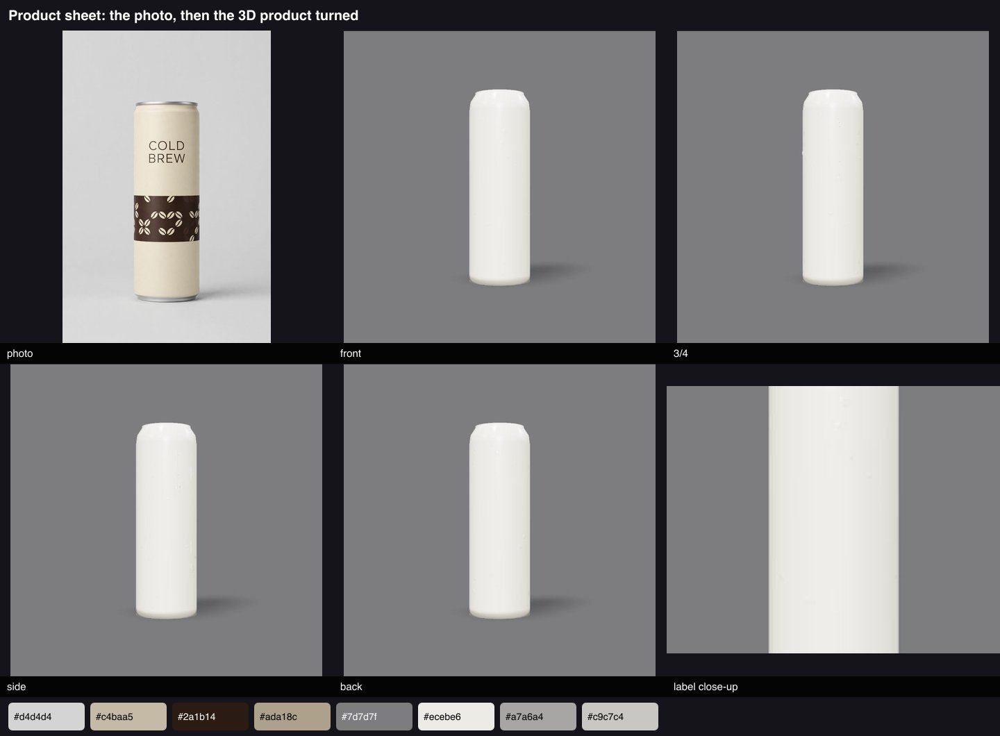
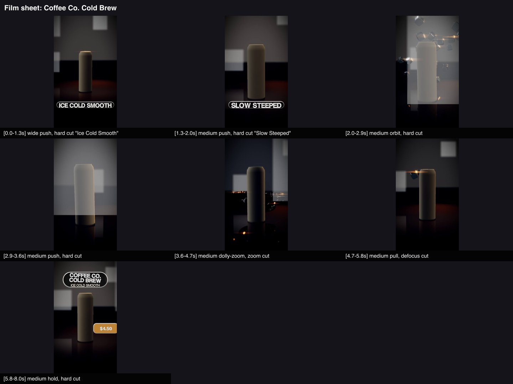
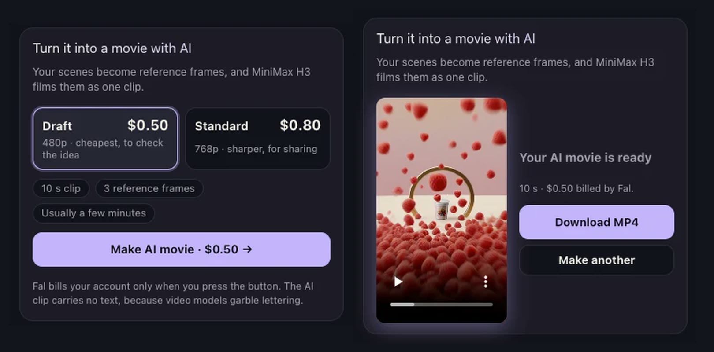

# MuseReels

> **One product photo and one sentence in. A directed 3D ad out, in about four minutes, for cents.**
>
> Muse plans the film like a director: the board, the camera, the light, the set. Before anything is assembled, our own engine draws every part on a **sheet** and Muse checks it against your photo, so a wrong colour or a missing label is caught on a cheap picture, not in the finished ad. Feed it a product CSV and it does the whole catalog. When you like a film, export it as an MP4, or send it to a video model for a richer final cut.
>
> Built for the Meta Global AI Developer Hackathon (27 Oct – 4 Nov 2026) · Track: Startups · Theme: Build for Your World

<p align="center">
  
</p>

<p align="center"><em>Three real runs on 4 Nov 2026, one photo and one sentence each, 10 s, 9:16. Each product is a real 3D object wearing the customer's photo, with the title and price set in 3D type. Nothing is painted or edited by hand. Shot-by-shot frames are under <a href="#three-briefs-three-films">Three briefs, three films</a>.</em></p>

<p align="center">
  <a href="https://youtu.be/VFWEXzESuGU"><b>Watch the 3-minute demo</b></a> · <a href="#try-it-in-10-minutes"><b>Run it in 10 minutes</b></a> · <a href="https://github.com/khanzzirfan/pixitween-director"><b>Code (Apache 2.0)</b></a> · <b>Team:</b> Irfan
</p>

> **Judges, short on time?** Jump straight to **[Run it locally](#1-run-it-locally)**: one Muse API key, then `npm ci` and `npm run dev`, and open http://localhost:5173.

## Contents

| Understand it | Run it | Reference |
|---|---|---|
| [At a glance](#at-a-glance) | [Try it in 10 minutes](#try-it-in-10-minutes) | [Architecture](#architecture) |
| [What is new here](#what-is-new-here) | [1. Run it locally](#1-run-it-locally) | [Cost per film](#cost-per-film) |
| [Three briefs, three films](#three-briefs-three-films) | [2. Make a film from a photo and your voice](#2-make-a-film-from-a-photo-and-your-voice) | [Demo](#demo) |
| [How it works](#how-it-works) | [3. Watch the steps, then read the sheets](#3-watch-the-steps-then-read-the-sheets) | [Limitations](#limitations) |
| [Meta models used](#meta-models-used) | [4. Turn a whole catalog into ads](#4-turn-a-whole-catalog-into-ads) | [Built during the hackathon](#built-during-the-hackathon) |
| | [5. Export an MP4, or a final AI movie](#5-export-an-mp4-or-a-final-ai-movie) | [Licenses and credits](#licenses-and-credits) |
| | [Troubleshooting](#troubleshooting) | |

---

## At a glance

| | |
|---|---|
| **The problem** | A small shop has hundreds of products and no budget for a video shoot. Short vertical video is where buyers look, and a single product ad costs days of work. |
| **What we built** | A studio that turns one photo and one sentence, or a whole product CSV, into finished 10 s vertical 3D ads, each one directed by Muse and checked before it ships. |
| **Meta models** | **Muse Spark 1.3** directs and checks, **SAM 3.1** cuts the product out, **Muse Image** draws the elements, **Muse Voice Transcribe** takes a spoken brief. [Details](#meta-models-used). |
| **Proof** | Three films above from three different briefs, and a film for every one of the six products in the demo catalog. Every Meta call is logged per film. |
| **Speed and cost** | 2.5 to 5 minutes and $0.035 to $0.065 in Meta calls per film, measured on 4 Nov 2026 with the cheaper `muse-spark-1.3-contributor` tier. `muse-spark-1.3` is priced higher per token; see [Cost per film](#cost-per-film). |
| **Final cut** | Export the 3D film as an MP4 for free, or, once you like it, turn it into an AI movie: three frames of your 3D film guide Fal's MiniMax H3, about $0.50 for 10 s. [How](#5-export-an-mp4-or-a-final-ai-movie). |
| **Try it** | One API key and three commands. [A 10-minute path](#try-it-in-10-minutes). |

## What is new here

1. **Check the parts before the film.** Every product, element, set and finished film is drawn on a labelled sheet by our own 3D engine, not by an image model. A sheet costs only render time and shows exactly what the film will show, so Muse can review it against the photo and fix the board before the film is committed.
2. **The film is data, not a video.** Muse writes a board; code turns it into a composition JSON that our own GSAP + Three.js engine plays in the browser. That makes every film checkable by code rules, undoable, and exportable to MP4 at any time.
3. **The cheap 3D film is the plan for an expensive one.** A video model is costly and hard to steer. Here it only runs once you have approved the 3D film, and it gets that film's own frames as references, so the product, set, light and shot order are already settled.
4. **Muse directs, code keeps it safe.** Muse chooses the concept, shots, camera moves, light, grade, set and elements from the photo and the sentence. Code supplies the 3D world, builds the product body, and sets the title and price text, so the title and price are real text set by code, never letters drawn by an image model.

---

## Three briefs, three films

Three films made on 4 Nov 2026, each from **one product photo and one sentence**. Each film is 10 s, 9:16. Every frame here is rendered from the saved film by the same player you get in the browser. Cost is the Meta calls logged for that film.

### Pure Spoonful: berry yoghurt · $0.065

*Brief: a cinematic 10 s ad with a hook, a full spin of the tub, a macro push on the label, a dolly-zoom and a 2.5 s end hold.*

<p align="center">
  
</p>

Raspberries fall past the lens, the camera pushes onto the real label (the customer's photo, wrapped on a round 3D tub), cream and berries drift through the macro, and the end hold sets the tagline in 3D type.

### 7-Eleven Freshly Ground Coffee: $2.00 · $0.065

*Brief: "a 10 sec vertical coffee ad for morning energy. price is $2.00".*

<p align="center">
  
</p>

Warm bokeh and steam over a glossy dark counter that reflects the cup, a soft-focus whip between shots, and the price arriving as an orange tag on the end hold.

### Cold Brew: from $5.00 to $3.50 · $0.035

*Brief: "a cinematic ad for cold brew can, amazing swirl, enchanting, price $3.50 (it was before $5.00)".*

<p align="center">
  
</p>

Ribbons of coffee and cream loop around the can in 3D, the shot words come and go, and the end card shows the old price struck through beside the new one. This film used only Muse Spark calls (no element pictures), which is why it cost about half as much.

**Same pipeline, different films.** Each film has its own colour field, camera path, light, surface (matte tub, glossy cup, matte can), elements and end card, because Muse writes them from the photo and the sentence. What stays fixed in code is the frame around them: the 3D world and its safety rules, the product build, and the text layout.

---

## How it works



| # | Step | What happens | Typical time |
|---|------|--------------|--------------|
| 1 | **Parts** | SAM 3.1 cuts the product out. Muse Spark writes the **board**: a concept, 2 to 4 **lock lines** (things that must stay true in every shot, such as "the tub is white with a pink label"), the elements, a set and 5 to 10 shots from a fixed vocabulary of camera moves and cuts. Muse looks once at the photo to name the product's form (round, boxy, slab), and code sets the depth. Muse Image draws the element pictures. | 50 to 105 s |
| 2 | **Sheets** | Our engine renders a product sheet (the photo beside the 3D product from four sides), an element sheet and a set sheet. | 9 to 10 s |
| 3 | **Check** | One Muse look at the sheets beside the photo and the board: fine, or a list of problems and elements to drop. | 30 to 60 s |
| 4 | **Film sheet** | The film is built from JSON and checked by code rules (length, layout, title boxes), then drawn as a film sheet, one frame per shot, and Muse looks once. At most one board revision follows, and it also mends what the part sheets showed. | 80 to 200 s |
| 5 | **Commit** | The 3D film is saved with its storyboard. | 0 s |

The Plan tab shows each step live with a running clock, so a long Muse call is never silence. A product the pipeline cannot make (for example, a photo the product cannot be cut out of) ends as failed with a plain reason.

<p align="center">
  
</p>
<p align="center"><em>A <b>product sheet</b>: the photo (top left) beside the 3D product turned four ways, a label close-up and colour swatches. In this run the label had not loaded onto the can, and the check flagged it.</em></p>

<p align="center">
  
</p>
<p align="center"><em>A <b>film sheet</b>: one frame per shot, labelled with time, shot size, camera move and cut. Muse reads it once and revises the board before the film is committed. This is the same earlier run, with the missing label still visible: the kind of fault the sheets exist to surface (see <a href="#limitations">Limitations</a>).</em></p>

Design documents: [sheet film](docs/architecture/sheet-film-3d.md) · [cinematic assembly](docs/architecture/cinematic-assembly.md) · [catalog line-up](docs/architecture/catalog-lineup.md) · [MP4 export](docs/architecture/mp4-export.md).

## Meta models used

| Model | Id | What it does here | Call site |
|-------|----|-------------------|-----------|
| Muse Spark 1.3 | `muse-spark-1.3` | the board (strict JSON schema, lock lines), the product's form from the photo, the sheet check, the film sheet look, the board revision | [`server/meta/spark.ts`](server/meta/spark.ts) |
| SAM 3.1 | `sam-3.1` | the product cut-out: the outline the 3D body is built from, and the pixels it wears | [`server/meta/sam.ts`](server/meta/sam.ts) |
| Muse Image | `muse-image-1.0` | element pictures (berries, ice, steam) | [`server/meta/image.ts`](server/meta/image.ts) |
| Muse Voice Transcribe | `muse-voice-transcribe-1.0` | the spoken brief | [`server/meta/transcribe.ts`](server/meta/transcribe.ts) |

---

## Try it in 10 minutes

| Step | What you do | Time |
|------|-------------|------|
| 1 | [Run it locally](#1-run-it-locally): you need only a Muse API key | 3 min |
| 2 | [Make a film from a photo and a brief](#2-make-a-film-from-a-photo-and-your-voice) | 4 min, mostly waiting |
| 3 | [Watch the steps, then read the sheets](#3-watch-the-steps-then-read-the-sheets) | 1 min |
| 4 | [Turn a whole catalog into ads](#4-turn-a-whole-catalog-into-ads) | 1 min to start |
| 5 | [Export an MP4, or a final AI movie](#5-export-an-mp4-or-a-final-ai-movie) | 1 min, or a few minutes for the AI movie |

No time to run it? [Watch the 3-minute demo](https://youtu.be/VFWEXzESuGU).

### 1. Run it locally

**You need:**

- **Node.js 22 or newer**: `node -v`
- **ffmpeg**: `brew install ffmpeg` on macOS, `sudo apt install ffmpeg` on Debian or Ubuntu. Voice briefs need it, and MP4 export uses it outside Chrome.
- **Google Chrome**, recommended: it encodes MP4 in the page and handles the microphone best.
- **A Muse API key** from the Meta Model API. Nothing else needs a key.

```bash
git clone https://github.com/khanzzirfan/pixitween-director.git
cd pixitween-director
npm ci
cp .env.example .env
```

Open `.env` and set one line:

```bash
META_API_KEY=your-muse-api-key
```

`.env.example` already selects `META_SPARK_MODEL=muse-spark-1.3`. Every other setting has a working default. Start the app:

```bash
npm run dev
```

This starts the API on **:8787** and the studio on **:5173**. Open **http://localhost:5173**. To check the server sees your key:

```bash
curl -s localhost:8787/api/health
```

You should see `"metaConfigured":true` and `"ffmpeg":true`.

<p align="center">
  
</p>

### 2. Make a film from a photo and your voice

1. Drop a product photo anywhere on the page, or press 📎. You can add up to 6 photos; the first is the hero.
2. Press 🎙, say what you want, then press ■ to stop (up to 60 seconds). For example: *"A ten-second ad for this cold brew can. Dark, smooth, swirling coffee. End on the price, three fifty."*
3. Listen back if you like, then press **Send now** or **Make film**. Nothing is sent until you press one.

Prefer typing? Write the brief in the box and press Enter. Films are always vertical 9:16.

The studio moves through **Brief → Plan → Build → Review → Export**. When the film commits, the Plan tab shows the sheets as thumbnails (click one to open it large), the storyboard with each shot's camera move and length, and the time each step took. The player shows the finished 3D film.

<p align="center">
  
</p>

<p align="center"><em>The Plan tab of the Cold Brew film: parts 101 s, sheets 10 s, check 44 s, revision 51 s, film sheet look 105 s.</em></p>

### 3. Watch the steps, then read the sheets

While the film builds, open **Plan**: it shows the current step, how long it has run, the steps already done and the latest note from the pipeline. When it is done, the sheets sit above the storyboard. They are the evidence of what Muse checked: the product sheet, the element sheet, the set sheet and the film sheet.

### 4. Turn a whole catalog into ads

The catalog flow makes one 3D film per product, two at a time by default (`LINEUP_CONCURRENCY`, 1 to 4), in feed order. A failed film never stops the others, and a restart resumes unfinished products.

1. Press **New film**.
2. Drop a demo feed into the chat: [`fixtures/catalog/feed-6.csv`](fixtures/catalog/feed-6.csv) (three cold-brew cans and three mugs; **Try an example** uses it) or [`fixtures/catalog/feed-summer-surf.csv`](fixtures/catalog/feed-summer-surf.csv) (free stock photos, [credits](fixtures/catalog/surf/CREDITS.md)). Their photos are in the repository.
3. Press **Make film**. A tab appears for each product, and the studio follows each film as it finishes. **Stop** halts the films in progress.

Your own feed needs these columns, and the photos it names:

```
id,title,price,sale_price,currency,image_link,category,link,brand
```

**Tested on 4 Nov 2026:** all six products of `feed-6.csv` made a film, in about 10 to 15 minutes at the default concurrency. Coffee films took 2.5 to 4 minutes and $0.035 to $0.048 each; mug films 2.5 to 5 minutes and $0.058 to $0.065 each.

### 5. Export an MP4, or a final AI movie

**MP4.** Open a finished film, go to **Export**, pick a quality and press **Export video**. Chrome encodes in the page; other browsers send the frames to the server's ffmpeg. This costs nothing.

**AI movie.** When you are happy with the 3D film, the same panel can turn it into a final cut with a video model:

1. Add a Fal key in Settings (the gear). The button in the top bar then reads **Video key**. This is the visitor's own key and is billed by Fal, not by us.
2. Under **Turn it into a movie with AI**, pick **Draft** (480p, $0.05 per second, to check the idea) or **Standard** (768p, $0.08 per second, for sharing). The card shows the clip length, the number of reference frames and the price before anything is sent.
3. Press **Make AI movie**. The server renders one reference frame for every 3 s of the film from the 3D film itself, with the titles removed, and sends them to Fal's MiniMax H3 with one prompt: Muse's story and the shots in order, the same product, set, light and camera, and no new objects. A few minutes later, **Download MP4**.

<p align="center">
  
</p>
<p align="center"><em>The Pure Spoonful film turned into a 10 s AI movie: three frames of the 3D film in, one MiniMax H3 clip out, $0.50.</em></p>

The AI movie carries no title or price text, because video models garble lettering. The 3D film's MP4 keeps them. The clip is 5 to 15 s long.

### Troubleshooting

| You see | Do this |
|---------|---------|
| `metaConfigured: false` from `/api/health` | `META_API_KEY` is missing from `.env`. Restart `npm run dev` after setting it. |
| The voice brief fails, or `ffmpeg: false` | Install ffmpeg (see [Run it locally](#1-run-it-locally)), then restart. |
| 🎙 does nothing | Allow the microphone for `localhost:5173` in the browser's site settings. |
| You recorded, but nothing happens | A recording is not sent on its own: press **Send now** or **Make film**. |
| Asked for a passcode | Open Settings (the gear) and enter the Director code, or your own Muse key. |
| Port 8787 or 5173 already in use | Stop the other process, or set `PORT` in `.env`. |
| A film fails with "the product in it could not be cut out" | Use a photo with the product on a plain backdrop. `/api/films/<id>/events` shows which step failed. |

---

## Architecture

<p align="center">
  
</p>

The key idea: **the same Motion engine runs in two places.** In the browser it plays the film; on the server, in headless Chromium, it draws the sheets Muse checks and the frames the AI movie starts from. So what Muse reviews is exactly what the viewer sees.

| Folder | What it holds |
|--------|---------------|
| `server/` | the Hono API, the sheet film (`server/crew/sheet-film/`), the authoring and 3D product code, the Meta clients, catalog line-ups, the stores |
| `engine/` | the Motion engine: our own GSAP + Three.js player for one composition JSON, with its CLI and browser tests ([README](engine/README.md)) |
| `web/` | the React studio, the player, frame capture and export |
| `shared/` | contracts used by both sides: film state, storyboard, events, tools |
| `scripts/` | live checks, the cost-per-film calculator, the submission preflight |
| `fixtures/` | demo feeds and photos, recorded real-shape responses, hand-made compositions |
| `e2e/` | Playwright flows |
| `deploy/` | the container and the Fly.io setup |
| `docs/` | [sheet film](docs/architecture/sheet-film-3d.md), [turnaround design](docs/architecture/turnaround-3d.md), [architecture](docs/architecture.md), [3D](docs/3d.md), [local mode](docs/local-mode.md) |

<details>
<summary><b>All commands</b></summary>

| Command | What it does |
|---------|--------------|
| `npm run dev` | API on :8787 and studio on :5173 |
| `npm run dev:nowatch`, `npm run dev:server:nowatch` | the same as `dev` (or the API alone), but editing `server/**` cannot restart the server mid-film |
| `npm run dev:server`, `npm run dev:web` | the API alone (port 8787), or the studio alone (port 5173) |
| `npm run typecheck`, `npm run lint`, `npm test` | the offline gates: types, lint, unit tests (no network) |
| `npm run e2e` | browser flows with a scripted director |
| `npm run build`, `npm run check:bundle`, `npm run start` | build the studio, check the bundle holds no keys, run the server as the container does |
| `npm run db:import -- [DATA_DIR]` | import old file-based data under `DATA_DIR` into `DATA_DIR/director.db` (the server also does this on boot) |
| `npm run db:export-events -- <filmId> [DATA_DIR]` | write one film's events as JSONL to stdout, the format the report scripts read |
| `npm run corpus:films`, `npm run corpus:report` | load the analysed reference films and their craft lessons into `director.db`, then report which lessons were used |
| `npm run engine:cli` | the Motion engine CLI (`explain`, `qa`, `edit`, `undo`, `presets`, `effects`, `targets`), one JSON object per call |
| `npm run engine:e2e` | the Motion engine's own browser flows |
| `npm run r8:fixtures` | regenerate the engine's R8 test fixtures (`fixtures/r8`) |
| `npm run live -- <name> [--yes]` | live checks that spend money; a dry run unless `--yes` is passed |

Optional settings in `.env`: `DIRECTOR_PASSCODE` is the code that spends the server Muse key; visitors without it use their own key from Settings.

</details>

## Cost per film

Every Meta call is recorded as a `cost` event in the film's event log. `npm run db:export-events -- <filmId>` writes a film's log out of the database, and `npx tsx scripts/cost-per-film.ts <events.jsonl>` prints its full cost record.

A film's cost is its Muse Spark calls (about $0.005 each), a few Muse Image element pictures ($0.01 each) and SAM ($0.0025 per call). The sheets cost nothing: our engine renders them. Planning prices, from the vendor pages on 27 Oct 2026:

| Model | Price |
|-------|-------|
| Muse Spark 1.3 contributor | $0.10 per 1M tokens in, $0.20 per 1M tokens out |
| Muse Spark 1.3 | $1.25 per 1M tokens in, $4.25 per 1M tokens out |
| Muse Image | $0.01 per image |
| SAM 3.1 | $2.50 per 1,000 images |
| Muse Voice Transcribe | $0.18 per hour |

## Demo

- **Video (3 min):** [https://youtu.be/VFWEXzESuGU](https://youtu.be/VFWEXzESuGU)
- **Run it yourself:** see [Try it in 10 minutes](#try-it-in-10-minutes). You only need a Meta API key.

## Limitations

- **Meta has no video- or speech-generation model** (checked 27 Oct). Motion comes from our browser timeline, and there is no voice-over.
- **Every film shares one 3D scaffold.** The light rig, wall, ground and product body defaults are fixed in code; Muse varies the board, camera, grade, set and elements inside it. Films of similar products can feel alike, and a soft, fuzzy product (a rolled towel) can lose its texture under a strong grade, because the product is built as an extruded cut-out.
- **The 3D product wears one photo.** Its front is the photo and its back is a side colour. Round products are wrapped; other shapes are swept from the outline at a depth Muse names. A drawn back and a measured depth (the turnaround) are designed in [`docs/architecture/turnaround-3d.md`](docs/architecture/turnaround-3d.md) but not built.
- **Sheets can show a fault the film still has.** In an earlier run the cold-brew can rendered without its label on both sheets. Muse flagged it and revised the board, but a board revision cannot fix a texture that did not load. The later cold-brew film above shows its label; we have not proven the cause fixed.
- **Not every brief is followed to the letter.** The yoghurt brief asked for a full spin, and the tub does not turn. The pipeline revises the board once, then accepts what the code rules still flag and logs it.
- **A finished 3D film cannot be edited in chat yet.**
- **The AI movie has no text, and only MiniMax H3 is wired.** The title and price are not yet laid back over the AI clip, and the video model can still change details of the product: in the Pure Spoonful AI movie the tub and berries hold, but the small print under the artwork comes out as invented words. Other video models (Seedance, for example) are not connected.
- **Each Muse call takes 10 to 90 s**, so a film takes minutes, not seconds, and a catalog of six takes 10 to 15 minutes.
- **Muse Image returns 1920x1280 when asked for 1536x1024 and has no transparent output**, so every transparent layer comes from SAM. **Voice Transcribe repeats some words** ("our our"); the text is used as it is.

## Built during the hackathon

Everything here was written during the event; the git history starts on 28 Oct 2026. It was built with AI coding agents (Ralph TUI and Claude Code) from product requirement documents kept in [`ralph/`](ralph/README.md). The last of them, S23, is the sheet film described above; its modules are listed under "Built" in [`docs/architecture/sheet-film-3d.md`](docs/architecture/sheet-film-3d.md). What is new and what existed before the event: [`docs/new-vs-existing.md`](docs/new-vs-existing.md).

That includes the player: the **Motion engine** in [`engine/`](engine/README.md) is our own GSAP + Three.js player for the composition JSON, with its own CLI and browser tests.

**Dependencies we did not write:** `@meta-sam/parser` (Meta's parser for SAM output, under the SAM License), and third-party libraries such as React, Three.js, GSAP, Hono, sharp, zod and better-sqlite3 (see `package.json`).

## Licenses and credits

This repository is Apache-2.0 (see [`LICENSE`](LICENSE)). Images, audio and video: [`ASSET-CREDITS.md`](ASSET-CREDITS.md). Demo feed photos: [`fixtures/catalog/surf/CREDITS.md`](fixtures/catalog/surf/CREDITS.md). `@meta-sam/parser` is under the SAM License. The Meta models are used through the Meta Model API under Meta's terms.
