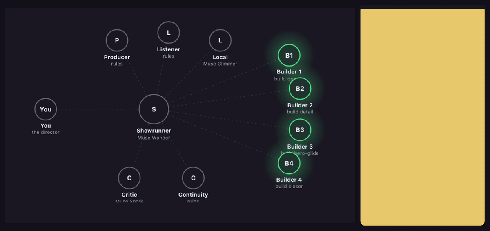
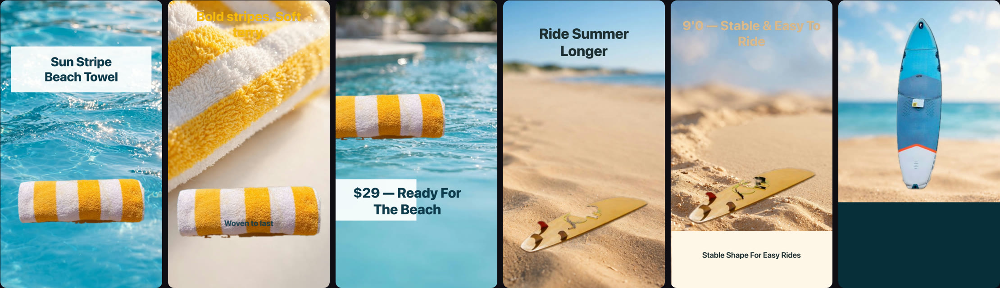
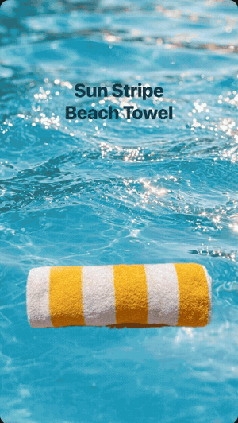
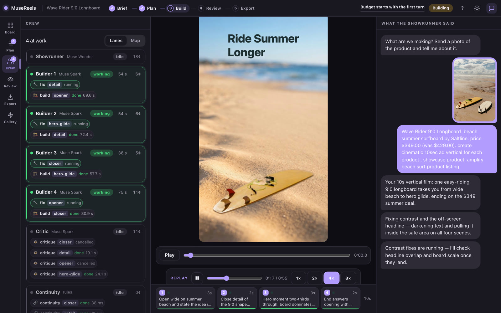
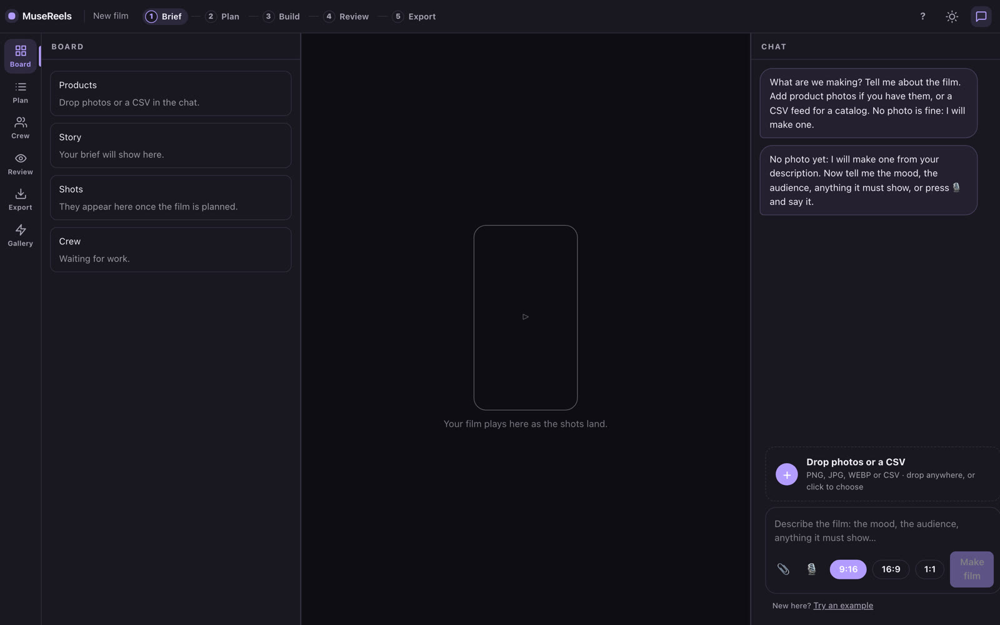
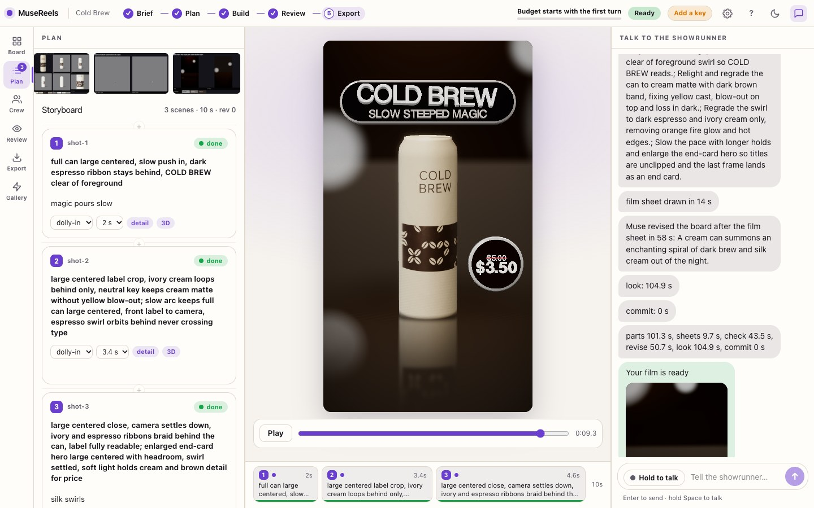
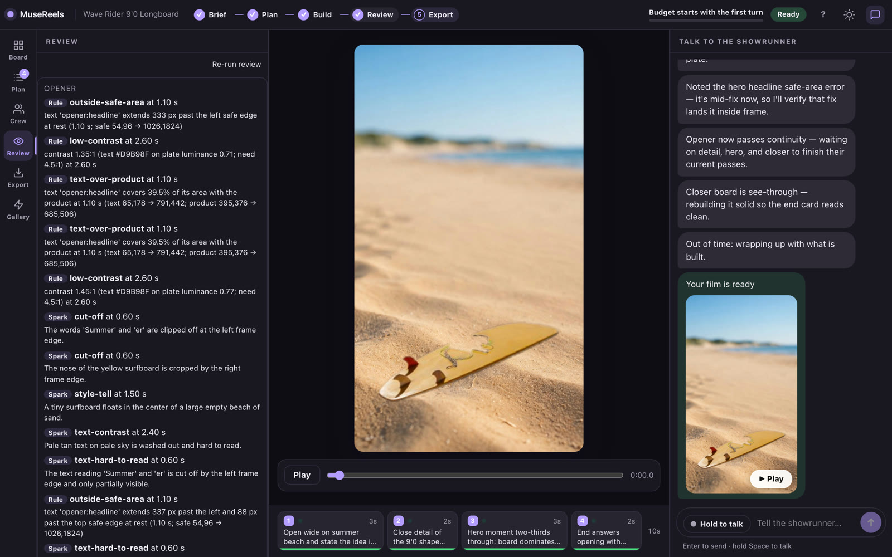
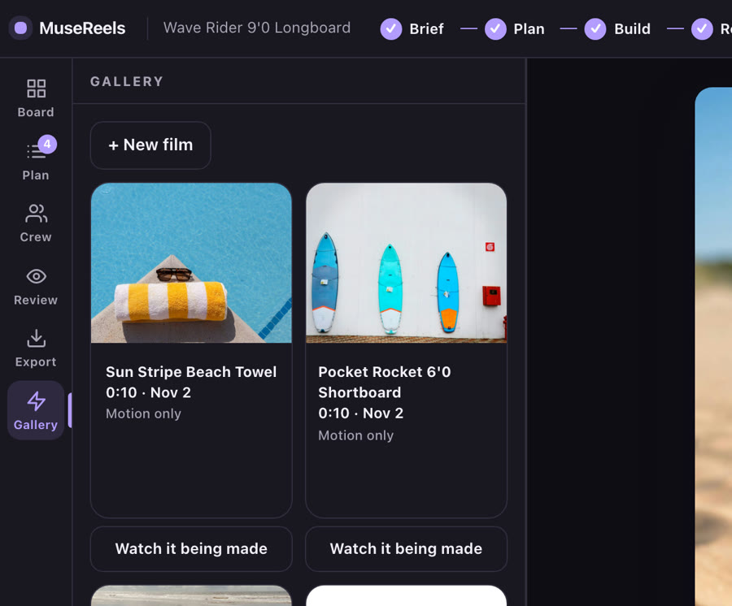
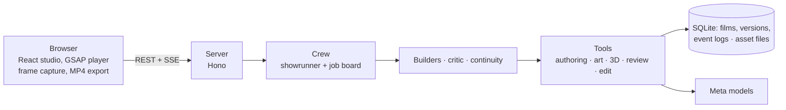

# MuseReels

> **Your whole catalog, as ads.** Drop in a product CSV, or one photo and a spoken brief, and a crew of Muse agents makes a checked, editable vertical video ad. A showrunner plans it, four builders work on different scenes at the same time, and a blind critic reviews every frame.
>
> Built for the Meta Global AI Developer Hackathon (27 Oct – 4 Nov 2026) · Track: Startups · Theme: Build for Your World

<!-- OWNER:gif -->

<p align="center">
  
</p>

<p align="center"><em>The crew map, replayed from a real run at 4× speed. The <b>Muse Wonder showrunner</b> sits at the centre with you, the director, on its left. Each packet is a job: builds and fixes go out to the four <b>Muse Spark builders</b>, and frames go to the <b>critic</b> and <b>continuity</b> checks, whose findings come back as fixes. On the right, the film fills in as each scene lands.</em></p>

**Live:** <!-- OWNER:live-url --> · **Demo video (3 min):** <!-- OWNER:video-url --> · **Code:** <!-- OWNER:repo-url --> · **Team:** <!-- OWNER:team -->

## How it all works, in one picture

<p align="center">
  
</p>

---

## For judges: a 10-minute path

| Step | What you do | Time |
|------|-------------|------|
| 1 | [Run it locally](#1-run-it-locally): you only need a Muse API key | 3 min |
| 2 | [Make a film from one photo and your voice](#2-make-a-film-from-a-photo-and-your-voice) | 4 min, mostly waiting |
| 3 | [Talk to the showrunner while it works](#3-talk-to-the-showrunner-while-it-works) | 1 min |
| 4 | [Turn a whole catalog into ads](#4-turn-a-whole-catalog-into-ads) | 1 min to start |
| 5 | [Watch it being made, then export an MP4](#5-watch-it-being-made-then-export-an-mp4) | 1 min |

No key, or don't want to spend? [Free offline mode](#no-key-free-offline-mode) runs the whole crew with scripted agents.

---

## What it does

Every frame below is from a real run of the app on the demo feed in [`fixtures/catalog/feed-summer-surf.csv`](fixtures/catalog/feed-summer-surf.csv). The product photos are free stock photos ([credits](fixtures/catalog/surf/CREDITS.md)), and *Saltline* is a made-up brand.

<p align="center">
  
</p>

<table>
  <tr>
    <td align="center" width="50%"><br><sub><b>Sun Stripe Beach Towel</b> · 10 s, 9:16</sub></td>
    <td align="center" width="50%"><br><sub><b>Wave Rider 9'0 Longboard</b> · 10 s, 9:16, with the sale price</sub></td>
  </tr>
</table>

Each film is a composition of layers, not a rendered video: a set painted by Muse Image, the product cut out by SAM 3.1, and the title and price set from the feed. The browser plays it on a GSAP timeline. Because it is data, an edit changes only what it touches, every version can be undone, and the title and price are always exactly the feed's.

## Demo

- **Live gallery:** <!-- OWNER:live-url -->. Open any crew film and press **Watch it being made** to see the crew work. It needs no passcode and costs nothing.
- **Video (3 min):** <!-- OWNER:video-url -->
- **Offline, with no keys:** run `npx tsx scripts/demo-film.ts load data-fake`, then `npm run dev:fake`. The gallery lists *Morning Ritual*, a film recorded with the fake crew, and its replay plays.

---

## How it works, step by step

1. **You brief it.** Give it 0–6 product photos and a brief, typed or spoken. With no photo, Muse Image makes one from the brief.
2. **The showrunner plans.** Muse Wonder writes a storyboard (scenes, durations, camera moves, on-screen copy) and a style bible, then posts one job per scene.
3. **Builders work in parallel.** Four Muse Spark builders each take a scene. They call tools to paint the set, cut out the product with SAM, place text and animate. Every edit is validated and versioned.
4. **Nobody marks their own work.** A critic that never sees the storyboard reviews captured frames, and measured rules check contrast, safe areas, text over the product, and what leaves the frame. Their findings come back as fix jobs.
5. **You can step in at any time.** A message, typed or spoken, goes to the showrunner, which changes only the scenes it touches. A per-film budget (default $1.50) stops new jobs once it is spent.

<p align="center">
  
</p>
<p align="center"><em>The Crew view mid-run: each lane shows its jobs, timings and cost in cents. On the right the showrunner explains what it is doing: "Fixing contrast and the off-screen headline…"</em></p>

## Meta models used

| Model | Id | What it does here | Call site |
|-------|----|-------------------|-----------|
| Muse Wonder | `muse-wonder-1.0` | the showrunner: plans, sets the style bible, dispatches jobs, answers you | [`server/llm/wonder-backend.ts`](server/llm/wonder-backend.ts) |
| Muse Spark 1.3 | `muse-spark-1.3-contributor` | the storyboard (strict JSON schema), the builders' parallel tool calls, frame review, chat edits | [`server/meta/spark.ts`](server/meta/spark.ts) |
| Muse Image | `muse-image-1.0` | scene sets ("plates") and product shots | [`server/meta/image.ts`](server/meta/image.ts) |
| SAM 3.1 | `sam-3.1` | product cut-outs: one transparent layer per photo | [`server/meta/sam.ts`](server/meta/sam.ts) |
| Muse Voice Transcribe | `muse-voice-transcribe-1.0` | the spoken brief, and push-to-talk to the showrunner | [`server/meta/transcribe.ts`](server/meta/transcribe.ts) |

---

## 1. Run it locally

**You need:**

- **Node.js 22 or newer**: `node -v`
- **ffmpeg**: `brew install ffmpeg` on macOS, `sudo apt install ffmpeg` on Debian or Ubuntu. Voice briefs need it, because the server converts your recording to WAV before transcribing it. It is also used for MP4 export outside Chrome.
- **Google Chrome**, recommended: it encodes MP4 in the page and handles the microphone best.
- **A Muse API key** from the Meta Model API. Nothing else needs a key.

```bash
git clone <this repository> pixitween-director
cd pixitween-director
npm ci
cp .env.example .env
```

Open `.env` and set one line:

```bash
META_API_KEY=your-muse-api-key
```

Every other setting has a working default. Start the app:

```bash
npm run dev
```

This starts the API on **:8787** and the studio on **:5173**. Open **http://localhost:5173**.

To check the server sees your key:

```bash
curl -s localhost:8787/api/health
```

You should see `"metaConfigured":true` and `"ffmpeg":true`.

<p align="center">
  
</p>

---

## 2. Make a film from a photo and your voice

1. Drop a product photo anywhere on the page, or press the 📎 button. You can add up to 6 photos: the first is the hero, and the film cuts between the rest. You can also add none, and it will make one.
2. Press 🎙, say what you want, then press ■ to stop. Up to 60 seconds. For example: *"A ten-second vertical ad for this beach towel. Bright, summery, by the pool. End on the price, twenty-nine dollars."*
3. Listen back if you like. Then press **Send now** in the chat, or **Make film**. Nothing is sent until you press one.
4. Films are always vertical 9:16 reels; there is no size to pick.

Prefer typing? Write the brief in the box and press Enter.

The studio moves through **Brief → Plan → Build → Review → Export**. Within about a minute the **Plan** tab shows the storyboard: each scene with its copy, camera move and duration, and its status (building, reviewing, done). The player fills in as the shots land.

<p align="center">
  
</p>

A film takes a few minutes and usually costs between $0.15 and $1.00 in Meta calls. Every call is logged; see [Cost per film](#cost-per-film).

---

## 3. Talk to the showrunner while it works

While the crew is building, use the box under **Talk to the showrunner**:

- Type, for example *"make the price bigger on the last scene"*, and press Enter.
- Or **hold to talk**: hold the button, or hold Space, speak, and let go.

The showrunner reads your message and changes only the scenes it touches. Builders on other scenes keep going.

Open **Review** to see what the critic and the rules found, each finding tied to a scene and a time:

<p align="center">
  
</p>

---

## 4. Turn a whole catalog into ads

The catalog flow makes one film per product, two at a time by default (`LINEUP_CONCURRENCY`, 1–4), in feed order.

1. Press **New film**.
2. Drop the demo feed [`fixtures/catalog/feed-summer-surf.csv`](fixtures/catalog/feed-summer-surf.csv) into the chat. Its photos are in the repository, so nothing else is needed. You can also press **Try an example** for a smaller feed.
3. Press **Make film**. A tab appears for each product, and the studio follows the crew as each film finishes. **Stop** halts the films in progress and starts no more.

Your own feed needs these columns:

```
id,title,price,sale_price,currency,image_link,category,link,brand
```

Add the photos it names. The board lists any product still missing a photo.

How a catalog clip is made:

- **SAM 3.1** cuts each distinct photo out once.
- **Muse Image** paints one set per look and product class.
- The title, price badge (with the struck-through old price on a sale) and brand mark come straight from the feed.
- A **verifier** checks every frame from the clip's JSON before anything is rendered. It checks that the price stays inside its badge, that text sits above the product, that the product stands on a surface, and that nothing leaves the frame.

---

## 5. Watch it being made, then export an MP4

Open **Gallery** in the left rail. Every finished film has **Watch it being made**, a replay of the crew's real event log at 1×, 2×, 4× or 8×. The replay costs nothing: no model is called. The crew map at the top of this page was recorded from one. In the replay, open **Crew** and switch **Lanes / Map** to watch the jobs move.

<p align="center">
  
</p>

To get a video file, open a film, go to **Export**, choose **MP4** and press **Export video**. Chrome encodes in the page. Other browsers upload the frames to the server's ffmpeg. See [docs/architecture/mp4-export.md](docs/architecture/mp4-export.md).

---

## No key? Free offline mode

This runs the whole app with a scripted crew and scripted art. It needs no key, makes no network calls and costs nothing:

```bash
npm run dev:fake
```

Open **http://localhost:5180**. It runs on its own data folder and ports, so it never touches your real films.

To have a recorded crew film in the gallery, with a replay that plays:

```bash
npx tsx scripts/demo-film.ts load data-fake
```

---

## Troubleshooting

| You see | Do this |
|---------|---------|
| `metaConfigured: false` from `/api/health` | `META_API_KEY` is missing from `.env`. Restart `npm run dev` after setting it. |
| The voice brief fails, or `ffmpeg: false` | Install ffmpeg (see [Run it locally](#1-run-it-locally)), then restart. |
| 🎙 does nothing | Allow the microphone for `localhost:5173` in the browser's site settings. |
| You recorded, but nothing happens | A recording is not sent on its own: press **Send now** or **Make film**. |
| Asked for a passcode | Open Settings (the gear) and enter the Director code, or your own Muse key. |
| Port 8787 or 5173 already in use | Stop the other process, or set `PORT` in `.env`. |
| A film stops early with "Out of time" or a budget message | The crew finishes with what is built once the per-film budget is spent. Raise `CREW_FILM_BUDGET_USD` in `.env` (default 1.50). |

---

## Commands

| Command | What it does |
|---------|--------------|
| `npm run dev` | API on :8787 and studio on :5173 |
| `npm run dev:fake` | the whole app offline, on ports 8790 and 5180 and folder `data-fake`: scripted crew, no keys, no spend |
| `npm run dev:nowatch`, `npm run dev:server:nowatch` | the same as `dev` (or the API alone), but editing `server/**` cannot restart the server mid-film |
| `npm run dev:server`, `npm run dev:web` | the API alone (port 8787), or the studio alone (port 5173) |
| `npm run typecheck`, `npm run lint`, `npm test` | the offline gates: types, lint, unit tests (no network) |
| `npm run e2e`, `npm run e2e:crew` | browser flows with the fake director and the fake crew |
| `npm run build`, `npm run check:bundle`, `npm run start` | build the studio, check the bundle holds no keys, run the server as the container does |
| `npm run db:import -- [DATA_DIR]` | import old file-based data under `DATA_DIR` into `DATA_DIR/director.db` (the server also does this on boot) |
| `npm run db:export-events -- <filmId> [DATA_DIR]` | write one film's events as JSONL to stdout, the format the report scripts read |
| `npm run corpus:films`, `npm run corpus:report` | load the analysed reference films and their craft lessons into `director.db`, then report which lessons were used and how those films ended |
| `npm run engine:cli` | the Motion agent CLI (`explain`, `qa`, `edit`, `undo`, `presets`, `effects`, `targets`), one JSON object per call |
| `npm run engine:e2e` | the Motion engine's own browser flows, from `engine/playwright.config.ts` |
| `npm run r8:fixtures` | regenerate the engine's R8 test fixtures (`fixtures/r8`) |
| `npm run live -- <name> [--yes]` | live checks that spend money; a dry run unless `--yes` is passed |

Optional settings in `.env`: `PRODUCT_3D=true` turns on 3D product shots, `CREW_FILM_BUDGET_USD` sets the budget per film, and `DIRECTOR_PASSCODE` is the code that spends the server Muse key. Visitors without that code use their own key from Settings. The Export panel's "Make AI movie" button sends a finished film's scenes to Fal's MiniMax H3 as reference frames and gets one clip back; its price is on the button, and `FAL_API_KEY=<your key> npm run live -- s22-ai-video --film=<id>` runs the same path from the terminal. A Fal key saved in Settings is spent only for that browser session and only from the IP that saved it. The Fal key is optional and always the visitor's own: the server has none to spend.

---

## Architecture



| Folder | What it holds |
|--------|---------------|
| `server/` | the Hono API, the crew, the agents and their tools, the Meta clients, catalog line-ups, the stores |
| `engine/` | the Motion engine: our own GSAP + Three.js player for one composition JSON, with its CLI and browser tests |
| `web/` | the React studio, the player, frame capture, export and replay |
| `shared/` | contracts used by both sides: film state, storyboard, events, crew, tools |
| `scripts/` | live checks, the cost-per-film calculator, the crew report, the submission preflight |
| `fixtures/` | demo feeds and photos, recorded real-shape responses, hand-made compositions |
| `e2e/` | Playwright flows, with the fake director and the fake crew |
| `deploy/` | the container and the Fly.io setup |
| `docs/` | how it works: [crew](docs/crew.md), [architecture](docs/architecture.md), [3D](docs/3d.md), [local mode](docs/local-mode.md) |

---

## Cost per film

<!-- OWNER:cost-table -->

Every Meta call is recorded as a `cost` event in the film's event log. `npx tsx scripts/cost-per-film.ts <events.jsonl>` prints a film's full record, and `npm run db:export-events -- <filmId>` writes a film's log out from the database. The crew has a budget per film (`CREW_FILM_BUDGET_USD`, default 1.50) and refuses new jobs once it is spent.

Planning prices, from the vendor pages on 27 Oct 2026:

- Muse Spark 1.3 contributor: $0.10 per 1M tokens in, $0.20 per 1M tokens out
- Muse Image: $0.01 per image
- SAM 3.1: $2.50 per 1,000 images
- Muse Voice Transcribe: $0.18 per hour

Replays and 3D scenes cost nothing.

## Limitations

- **Meta has no video- or speech-generation model** (checked 27 Oct). Motion comes from the browser timeline, and there is no voice-over.
- **Muse Spark's video review is coarse.** It sees sampled stills and hears no audio, so review uses frames as images plus measured rules, and catalog clips are checked from their JSON before anything is rendered.
- **Voice Transcribe repeats some words** ("our our") and gives turn-level timestamps only. The text goes to the showrunner as it is.
- **Muse Image returns 1920x1280 when asked for 1536x1024, and has no transparent output**, so every transparent layer comes from SAM.
- **3D product shots show the front of the product** as photographed, and turn at most 35° either side. Soft packaging should stay in 2D motion.
- **A film is not always clean.** Some finished films still show issues the critic flagged (for example, text cropped at the edge) when the time or budget ran out before the fix landed. The Review tab lists them.

## Built during the hackathon

Everything here was written during the event; the git history starts on 28 Oct 2026. It was built with AI coding agents (Ralph TUI and Claude Code) from PRDs kept in `ralph/`: 14 PRDs for the first build, then 10 more for the crew, the replay, the 3D product shots and the studio shell. What is new and what existed before the event: [`docs/new-vs-existing.md`](docs/new-vs-existing.md).

That includes the player. The **Motion engine** in [`engine/`](engine/README.md) is our own GSAP + Three.js player for the composition JSON the agents write, built during the hackathon, with its own CLI (`npm run engine:cli`) and browser tests (`npm run engine:e2e`).

**Dependencies we did not write:**

| Dependency | What it is | How we use it |
|------------|-----------|---------------|
| `@meta-sam/parser` | Meta's parser for SAM output, under the SAM License | reading SAM 3.1 results |
| Third-party libraries | React, Three.js, GSAP, Hono, sharp, zod, better-sqlite3 and others | see `package.json`; licences are in the packages |

## Licenses and credits

This repository is Apache-2.0 (see [`LICENSE`](LICENSE)). Images, audio and video: [`ASSET-CREDITS.md`](ASSET-CREDITS.md). Demo feed photos: [`fixtures/catalog/surf/CREDITS.md`](fixtures/catalog/surf/CREDITS.md). `@meta-sam/parser` is under the SAM License. The Meta models are used through the Meta Model API under Meta's terms.
