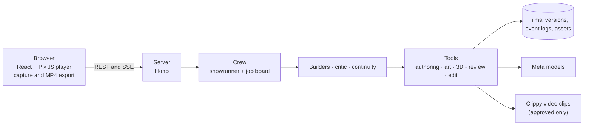

# PixiTween Director

> An AI film director that makes product videos as **editable layers**, not flat MP4s. Built for the Meta Global AI Developer Hackathon (27 Oct – 4 Nov 2026).

<!-- OWNER:gif -->

**Live:** <!-- OWNER:live-url --> · **Demo video (3 min):** <!-- OWNER:video-url --> · **Code:** <!-- OWNER:repo-url --> · **Track:** Startups · **Theme:** Build for Your World

## What it does

Give it a product photo and a brief, typed or spoken. A crew of Muse agents plans the film and builds it as a timeline of layers while you keep directing it:

1. **Muse Voice Transcribe** turns a voice memo into the brief. **Muse Wonder** is the showrunner: it writes the storyboard and a style bible, then hands out jobs. See [`docs/crew.md`](docs/crew.md).
2. **Muse Spark** builders work on different scenes **at the same time**. A message you send while they work ("add a sunset scene after the second one") changes the plan, and only the scenes it touches are rebuilt.
3. For every scene the crew picks the cheapest technique that tells the shot, and says why: **motion** (stills, layers and camera moves; cents), **3D** (the real product, wearing its photo's label, turning in studio light; free) or **generate** (a real video clip; credits, and only after you approve the price). See [`docs/3d.md`](docs/3d.md).
4. **Muse Image** paints each scene's background. **SAM 3.1** cuts the product out as a transparent layer, so the camera moves through real depth and a headline can sit behind the product.
5. The film plays instantly in the browser on our PixiJS timeline engine. A **blind critic** that never sees the storyboard looks at captured frames and reports what is on screen; rule checks measure overlaps and safe areas. The showrunner fixes what hurts the film.
6. Ask for three takes of a scene and pick the best. Every edit is validated, versioned and undoable. **Local mode** runs chat edits on **Muse Glimmer 30B** on your own machine. A finished film can be replayed as a show: *Watch it being made*.

## Demo

- Live gallery: <!-- OWNER:live-url -->. Open any crew film and press **Watch it being made** to see the crew work, with no passcode and no cost.
- Video: <!-- OWNER:video-url -->.
- Offline, no keys: `npx tsx scripts/demo-film.ts load`, then `npm run dev`. The gallery lists *Morning Ritual*, a film recorded with the fake crew (`DIRECTOR_FAKE=1`), and its replay plays.

## Meta models used

| Model | Id | What it does here | Call site |
|-------|----|-------------------|-----------|
| Muse Wonder | `muse-wonder-1.0` | the showrunner: plans, sets the style bible, dispatches and answers | [`server/llm/wonder-backend.ts`](server/llm/wonder-backend.ts) |
| Muse Spark 1.3 | `muse-spark-1.3-contributor` | storyboard (strict JSON schema), parallel tool calls that build each scene, frame review, chat edits | [`server/meta/spark.ts`](server/meta/spark.ts) |
| Muse Image | `muse-image-1.0` | scene backgrounds and product shots | [`server/meta/image.ts`](server/meta/image.ts) |
| SAM 3.1 | `sam-3.1` | product cut-outs (transparent layers) and product-visibility checks in generated clips | [`server/meta/sam.ts`](server/meta/sam.ts) |
| Muse Voice Transcribe | `muse-voice-transcribe-1.0` | the spoken brief and push-to-talk to the showrunner | [`server/meta/transcribe.ts`](server/meta/transcribe.ts) |
| Muse Glimmer 30B (open weights) | `muse-glimmer:30b-mlx` through Ollama | **Local mode**: chat edits and frame review on your own hardware | [`server/llm/glimmer-backend.ts`](server/llm/glimmer-backend.ts) |
| Muse Spark Open (open weights) | on Baseten | optional backend for chat edits (`EDIT_BACKEND=spark-open`) | [`server/llm/spark-open-backend.ts`](server/llm/spark-open-backend.ts) |

## Architecture



The full picture, with the film lifecycle and the tool list, is in [`docs/architecture.md`](docs/architecture.md).

## Built during the hackathon

Everything in this repository was written during the event: its git history starts on 28 Oct 2026. It was written with AI coding agents (Ralph TUI with a local model, and Claude Code), from PRDs kept in `ralph/`: 14 PRDs for the first build, then 10 more for the crew, the replay, the 3D product shots and the studio shell. See [`docs/new-vs-existing.md`](docs/new-vs-existing.md).

| Folder | What it holds |
|--------|---------------|
| `server/` | the Hono API, the crew, the agents, the tools, the Meta and Clippy clients, the stores |
| `web/` | the React studio, the player, frame capture, export and replay |
| `shared/` | contracts used by both: film state, storyboard, events, crew, tools |
| `scripts/` | live checks, the cost-per-film calculator, the crew report, the submission preflight |
| `deploy/` | the container and Fly.io setup |
| `e2e/` | the Playwright flows, with the fake director and the fake crew |
| `fixtures/` | recorded real-shape responses and hand-made compositions |
| `docs/`, `ralph/` | how it works, and the PRDs it was built from |

## Pre-existing dependencies

| Dependency | What it is | How we use it |
|------------|-----------|---------------|
| [`reacthub-pixitweenjs`](https://www.npmjs.com/package/reacthub-pixitweenjs) | our own PixiJS and GSAP timeline engine, published on npm before the hackathon under its own source-available licence (free for individuals, non-profits and organisations under €1M revenue) | the player: it renders the composition JSON the agents write. Installed from npm; never copied or edited here. Gaps are tracked in [`ENGINE-NEEDS.md`](ENGINE-NEEDS.md) |
| Clippy video-generation service | a pre-existing remote service | only for approved *generate* scenes ([`server/clippy/mcp.ts`](server/clippy/mcp.ts)) |
| `@meta-sam/parser` | Meta's parser for SAM output, under the SAM License | reading SAM 3.1 results |
| Third-party libraries | React, PixiJS, Hono, Three.js, sharp, zod and others | see `package.json`; licences in the packages |

## Run it locally

```bash
git clone <this repository> && cd pixitween-director
npm ci
cp .env.example .env        # set META_API_KEY; optional: CLIPPY_*, GLIMMER_*, DIRECTOR_PASSCODE
npm run dev                 # web on :5173, API on :8787
```

With no keys, `DIRECTOR_FAKE=1 npm run dev` runs the whole crew offline with scripted agents and no spend. Turn on 3D product shots with `PRODUCT_3D=true`.

| Command | What it does |
|---------|--------------|
| `npm run typecheck`, `npm run lint`, `npm test` | the offline gates: types, lint, unit tests |
| `npm run e2e`, `npm run e2e:crew`, `npm run e2e:cartoon` | the browser flows: the single director, the crew with four builders at once, and the toy-studio cartoon crew |
| `npm run dev:server`, `npm run dev:web` | the API alone (port 8787), or the web app alone (port 5173) |
| `npm run dev:nowatch`, `npm run dev:server:nowatch` | the same without file watching, so editing `server/**` cannot restart the server and kill a live film |
| `npm run build`, `npm run check:bundle`, `npm run start` | build the web app, check it holds no keys, run the server as the container does |
| `npm run live -- <name> [--yes]` | live checks that spend money: a dry run unless `--yes` is passed |
| `npx tsx scripts/preflight-submission.ts` | what still blocks the submission |

## Cost per film

<!-- OWNER:cost-table -->

Every Meta and Clippy call is recorded as one `cost` event in the film's event log, so `npx tsx scripts/cost-per-film.ts data/films/<id>/events.jsonl` prints the complete record for a film. The crew has a budget per film (`CREW_FILM_BUDGET_USD`, default 1.50) and refuses new jobs once it is spent.

Planning prices, from the vendor pages on 27 Oct 2026: Muse Spark 1.3 contributor $0.10 / $0.20 per 1M tokens in and out; Muse Image $0.01 per image; SAM 3.1 $2.50 per 1,000 images and $0.20 per 1,000 video frames; Muse Voice Transcribe $0.18 per hour. A generated clip is billed by the video provider (25 Clippy credits reserved per clip). 3D scenes cost nothing to render.

## Limitations

- **Muse Spark's video review is coarse.** It sees sampled stills and hears no audio on 1.3, and it missed a caption crossing the product in our test. So review uses frames as images plus measured rules, and generated clips are checked with SAM video tracking.
- **Meta has no video- or speech-generation model** (checked 27 Oct against the docs, the live model list and the open-weight models). Motion comes from the browser timeline; real footage only from an approved generate clip; there is no Meta voice-over.
- **Voice Transcribe repeats some words** ("our our") and gives turn-level timestamps only; we pass the text to Spark as it is.
- **Glimmer is the local and private lane, not the fast one.** On an Apple M3 Max it took 20 to 33 s per tool turn, against 13 to 16 s for Spark.
- Muse Image returns 1920x1280 when asked for 1536x1024 and cannot output transparent backgrounds, so every transparent layer comes from SAM.
- 3D product shots show the front of the product as photographed: the sides take its edge colour, and the turn is limited to 35 degrees either side. Soft or deformable packaging should stay in motion. The realism score and the cost of a live 3D film are still to be measured.
- The crew's wall time and cost per film on a live run are still to be measured. The first live run did not finish within 8 minutes before the finish policy was changed; the numbers will be in [`docs/crew.md`](docs/crew.md) once re-measured.

## Licenses and credits

This repository is Apache-2.0 (see [`LICENSE`](LICENSE)). The engine it plays on is a separate project under its own licence (see above). Images, audio and video in this repository: [`ASSET-CREDITS.md`](ASSET-CREDITS.md). `@meta-sam/parser` is under the SAM License. The Meta models are used through the Meta Model API under Meta's terms.

## Team

<!-- OWNER:team -->
