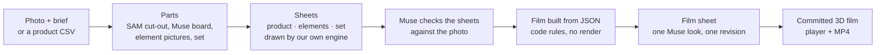
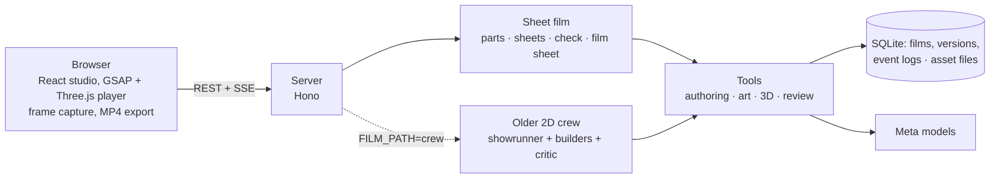

# MuseReels

> **Your whole catalog, as 3D ads.** Drop in a product CSV, or one photo and a brief, and Muse directs a real 3D film of your product: a board, a camera, light and a set. Before the film is assembled, the parts are drawn on **sheets** and Muse checks them against your photo, so a wrong colour, a missing label or a cropped product is caught on a cheap picture, not in the finished ad.
>
> Built for the Meta Global AI Developer Hackathon (27 Oct – 4 Nov 2026) · Track: Startups · Theme: Build for Your World

<!-- OWNER:gif -->

<p align="center">
  
</p>

<p align="center"><em>A <b>film sheet</b> from a real run: one frame per shot, labelled with time, size, camera move and cut. Muse looks at this sheet once and fixes the board before the film is committed. (The can's label did not reach this render. That is the kind of fault the sheets exist to show; see <a href="#limitations">Limitations</a>.)</em></p>

<p align="center">
  
</p>

<p align="center"><em>The older 2D crew, replayed from a real run at 4× speed (still available with <code>FILM_PATH=crew</code>). The crew map, replayed from a real run at 4× speed. The <b>Muse Wonder showrunner</b> sits at the centre with you, the director, on its left. Each packet is a job: builds and fixes go out to the four <b>Muse Spark builders</b>, and frames go to the <b>critic</b> and <b>continuity</b> checks, whose findings come back as fixes. On the right, the film fills in as each scene lands.</em></p>

**Live:** <!-- OWNER:live-url --> · **Demo video (3 min):** <!-- OWNER:video-url --> · **Code:** <!-- OWNER:repo-url --> · **Team:** <!-- OWNER:team -->

## The 3D film, in one picture



Every sheet is a render of the real 3D parts by our own engine, not an AI picture, so a sheet costs nothing but render time and shows exactly what the film will show.

### The older 2D crew, in one picture

The first version of the app (and `FILM_PATH=crew`) made a 2D film with a crew of agents. The picture below is that crew.

<p align="center">
  
</p>

---

## For judges: a 10-minute path

| Step | What you do | Time |
|------|-------------|------|
| 1 | [Run it locally](#1-run-it-locally): you only need a Muse API key | 3 min |
| 2 | [Make a film from one photo and a brief](#2-make-a-film-from-a-photo-and-your-voice) | 4 min, mostly waiting |
| 3 | [Watch the steps, then read the sheets](#3-watch-the-steps-then-read-the-sheets) | 1 min |
| 4 | [Turn a whole catalog into ads](#4-turn-a-whole-catalog-into-ads) | 1 min to start |
| 5 | [Watch it being made, then export an MP4](#5-watch-it-being-made-then-export-an-mp4) | 1 min |

No key, or don't want to spend? [Free offline mode](#no-key-free-offline-mode) runs the app with scripted agents.

**What is new since the first version** (all in this repository, with the PRDs that made it in [`ralph/`](ralph/README.md)):

- **Every film is 3D by default** (`FILM_PATH=3d`, PRD S23): one sequential pipeline that makes a film in about 2.5 to 5 minutes for about $0.04 to $0.07, where the 2D crew took over 11 minutes and about $1.
- **Sheets**: the product, its elements, the set and the finished film each drawn on one labelled sheet and checked by Muse before anything ships. Design: [`docs/architecture/sheet-film-3d.md`](docs/architecture/sheet-film-3d.md).
- **Lock lines**: the board names 2 to 4 things that must stay true in every shot (for example "the tub is white with a pink label") and the sheets are checked against them.
- **Live steps in the UI**: the Plan tab and crew map show which of the five steps is running and for how long, so a long Muse call is never silence.
- **Catalogs on the 3D path**: a CSV makes one 3D film per product; the demo feed makes all six. A cut-out that wrongly rejected a mug on a coaster is fixed.
- **Muse names the form, code writes the numbers**: a round tub no longer turns into a card; Muse reads the shape from the photo and code sets the depth.

---

## What it does

Every frame below is from a real run of the app on the demo feed in [`fixtures/catalog/feed-summer-surf.csv`](fixtures/catalog/feed-summer-surf.csv). The product photos are free stock photos ([credits](fixtures/catalog/surf/CREDITS.md)), and *Saltline* is a made-up brand.

<p align="center">
  
</p>

<table>
  <tr>
    <td align="center" width="50%"><br><sub><b>Sun Stripe Beach Towel</b> · 10 s, 9:16</sub></td>
    <td align="center" width="50%"><br><sub><b>Wave Rider 9'0 Longboard</b> · 10 s, 9:16, with the sale price</sub></td>
  </tr>
</table>

Each film is a composition written as JSON, not a rendered video: the product is a real 3D shape wearing your photo, in a set drawn for the board, with a camera, light, and the title and price set from the feed. The browser plays it on a GSAP and Three.js timeline. Because it is data, every version can be undone, the title and price are always exactly the feed's, and code rules can check the film before anything is rendered. The frames above are from the earlier 2D run; the sheet at the top is from the 3D path.

## Demo

- **Live gallery:** <!-- OWNER:live-url -->. Open any crew film and press **Watch it being made** to see the crew work. It needs no passcode and costs nothing.
- **Video (3 min):** <!-- OWNER:video-url -->
- **Offline, with no keys:** run `npx tsx scripts/demo-film.ts load data-fake`, then `npm run dev:fake`. The gallery lists *Morning Ritual*, a film recorded with the fake crew, and its replay plays.

---

## How it works, step by step

A new film runs five steps, one after the other. The Plan tab shows the current step with a running clock.

| # | Step | What happens | Typical time |
|---|------|--------------|--------------|
| 1 | **Parts** | SAM 3.1 cuts the product out. Muse Spark writes the **board**: a concept, 2 to 4 lock lines, the elements, a set and 5 to 10 shots from a fixed vocabulary of camera moves and cuts. Muse looks once at the photo to name the product's form (round, boxy, slab). Muse Image draws element pictures. | 50 to 95 s |
| 2 | **Sheets** | Our engine renders a product sheet (the photo and the 3D product from four sides), an element sheet and a set sheet. | 9 to 10 s |
| 3 | **Check** | One Muse look at the sheets beside the photo and the board: fine, or a list of problems and elements to drop. | 30 to 60 s |
| 4 | **Film sheet** | The film is built from JSON and checked by code rules (length, layout, title boxes). It is drawn as a film sheet, one frame per shot, and Muse looks once. At most one board revision follows, and it also mends whatever the part sheets showed. | 80 to 200 s |
| 5 | **Commit** | The 3D film is saved, and the storyboard for the Plan tab is written from the board. | 0 s |

Nobody edits a film by hand: to make films more cinematic we add words to the vocabulary and teach the assembler to draw them ([`docs/architecture/cinematic-assembly.md`](docs/architecture/cinematic-assembly.md)). A product the 3D path cannot make, for example a photo the product cannot be cut out of, ends as failed with a plain reason.

**Measured on the demo feed (4 Nov 2026):** coffee films 2.5 to 4 minutes and $0.035 to $0.048 each; mug films 2.5 to 5 minutes and $0.058 to $0.065 each. The earlier 2D crew on one film took 11 min 18 s and $1.02.

<p align="center">
  
</p>
<p align="center"><em>A product sheet. Muse compares the photo (top left) with the 3D product turned four ways, and the colour swatches. Here the check should, and did, flag the missing label.</em></p>

### The older 2D crew (`FILM_PATH=crew`)

1. **The showrunner plans.** Muse Wonder writes a storyboard and a style bible, then posts one job per scene.
2. **Builders work in parallel.** Four Muse Spark builders each take a scene, paint the set, cut out the product with SAM, place text and animate.
3. **Nobody marks their own work.** A critic that never sees the storyboard reviews captured frames, and measured rules check contrast, safe areas and what leaves the frame. Findings come back as fix jobs.
4. **You can step in at any time.** A message goes to the showrunner, which changes only the scenes it touches. A per-film budget (default $1.50) stops new jobs once it is spent.

We moved away from it because the 3D film needed about 4 minutes while the crew around it took over 11, and because judging 2D against 3D at the end spent time and money for little. It stays until a later PRD deletes it. In the 3D path there is no showrunner loop and no builders; the crew map shows only the Showrunner and Critic lighting up as the steps run.

<p align="center">
  
</p>
<p align="center"><em>The older 2D crew mid-run: each lane shows its jobs, timings and cost in cents.</em></p>

## Meta models used

| Model | Id | What it does here | Call site |
|-------|----|-------------------|-----------|
| Muse Wonder | `muse-wonder-1.0` | the showrunner of the older 2D crew (`FILM_PATH=crew`); not used in the 3D path | [`server/llm/wonder-backend.ts`](server/llm/wonder-backend.ts) |
| Muse Spark 1.3 | `muse-spark-1.3-contributor` | the board (strict JSON schema, lock lines), the form of the product from the photo, the sheet check, the film sheet look, board revisions; in the 2D crew also the builders and critic | [`server/meta/spark.ts`](server/meta/spark.ts) |
| Muse Image | `muse-image-1.0` | element pictures (berries, ice, steam) for the film; in the 2D crew also scene sets | [`server/meta/image.ts`](server/meta/image.ts) |
| SAM 3.1 | `sam-3.1` | the product cut-out: the shape and the pixels the 3D body wears | [`server/meta/sam.ts`](server/meta/sam.ts) |
| Muse Voice Transcribe | `muse-voice-transcribe-1.0` | the spoken brief, and push-to-talk to the showrunner | [`server/meta/transcribe.ts`](server/meta/transcribe.ts) |

---

## 1. Run it locally

**You need:**

- **Node.js 22 or newer**: `node -v`
- **ffmpeg**: `brew install ffmpeg` on macOS, `sudo apt install ffmpeg` on Debian or Ubuntu. Voice briefs need it, because the server converts your recording to WAV before transcribing it. It is also used for MP4 export outside Chrome.
- **Google Chrome**, recommended: it encodes MP4 in the page and handles the microphone best.
- **A Muse API key** from the Meta Model API. Nothing else needs a key.

```bash
git clone <this repository> pixitween-director
cd pixitween-director
npm ci
cp .env.example .env
```

Open `.env` and set one line:

```bash
META_API_KEY=your-muse-api-key
```

Every other setting has a working default. Start the app:

```bash
npm run dev
```

This starts the API on **:8787** and the studio on **:5173**. Open **http://localhost:5173**.

To check the server sees your key:

```bash
curl -s localhost:8787/api/health
```

You should see `"metaConfigured":true` and `"ffmpeg":true`.

<p align="center">
  
</p>

---

## 2. Make a film from a photo and your voice

1. Drop a product photo anywhere on the page, or press the 📎 button. You can add up to 6 photos: the first is the hero, and the film cuts between the rest. You can also add none, and it will make one.
2. Press 🎙, say what you want, then press ■ to stop. Up to 60 seconds. For example: *"A ten-second vertical ad for this beach towel. Bright, summery, by the pool. End on the price, twenty-nine dollars."*
3. Listen back if you like. Then press **Send now** in the chat, or **Make film**. Nothing is sent until you press one.
4. Films are always vertical 9:16 reels; there is no size to pick.

Prefer typing? Write the brief in the box and press Enter.

The studio moves through **Brief → Plan → Build → Review → Export**. While the film builds, the **Plan** tab lists the five steps with the current one marked and its clock running, and the **Crew** tab lights up the Showrunner and Critic. When the film commits, the Plan tab shows the sheets as thumbnails (click one to open it large) and the storyboard: each shot with its camera move and duration. The player then shows the finished 3D film.

<p align="center">
  
</p>

A 3D film takes about 2.5 to 5 minutes and, on the demo feed, cost $0.035 to $0.065 in Meta calls. Every call is logged; see [Cost per film](#cost-per-film).

---

## 3. Watch the steps, then read the sheets

While the film builds, open **Plan**: the current step, how long it has run, the steps already done and the latest note from the pipeline. Open **Crew** and the Showrunner and Critic light up with the step they are on.

When it is done, the sheets sit above the storyboard. They are the evidence of what Muse checked: the product sheet, the element sheet, the set sheet and the film sheet. Open **Review** to see what the rules found, each finding tied to a scene and a time:

<p align="center">
  
</p>

Chat edits of a finished 3D film are not built yet (PRD S23 leaves them out). The box under **Talk to the showrunner** still works for the older 2D crew.

---

## 4. Turn a whole catalog into ads

The catalog flow makes one 3D film per product, two at a time by default (`LINEUP_CONCURRENCY`, 1–4), in feed order. A failed film never stops the others, and a restart resumes unfinished products from `director.db`.

1. Press **New film**.
2. Drop a demo feed into the chat: [`fixtures/catalog/feed-6.csv`](fixtures/catalog/feed-6.csv) (three cold-brew cans and three mugs; **Try an example** uses it) or [`fixtures/catalog/feed-summer-surf.csv`](fixtures/catalog/feed-summer-surf.csv). Their photos are in the repository, so nothing else is needed.
3. Press **Make film**. A tab appears for each product, and the studio follows the crew as each film finishes. **Stop** halts the films in progress and starts no more.

Your own feed needs these columns:

```
id,title,price,sale_price,currency,image_link,category,link,brand
```

Add the photos it names. The board lists any product still missing a photo.

**Tested on 4 Nov 2026:** all six products of `feed-6.csv` made a film. The first run lost the three mugs because the cut-out check rejected a mug standing on a wooden coaster (SAM found the mug at 0.96 confidence, but it covered only 45% of the non-background area); the fix uses a confident named answer when the check would otherwise fail the film. The re-run made all three mugs for $0.058, $0.063 and $0.065. A feed takes minutes per product, so a six-product feed takes about 10 to 15 minutes at the default concurrency. The design is in [`docs/architecture/catalog-lineup.md`](docs/architecture/catalog-lineup.md).

---

## 5. Watch it being made, then export an MP4

Open **Gallery** in the left rail. Every finished film has **Watch it being made**, a replay of the crew's real event log at 1×, 2×, 4× or 8×. The replay costs nothing: no model is called. The crew map at the top of this page was recorded from one. In the replay, open **Crew** and switch **Lanes / Map** to watch the jobs move.

<p align="center">
  
</p>

Replays are recorded from the older crew's event log. To get a video file, open a film, go to **Export**, choose **MP4** and press **Export video**. Chrome encodes in the page. Other browsers upload the frames to the server's ffmpeg. See [docs/architecture/mp4-export.md](docs/architecture/mp4-export.md).

---

## No key? Free offline mode

This runs the whole app with a scripted crew and scripted art. It needs no key, makes no network calls and costs nothing:

```bash
npm run dev:fake
```

Open **http://localhost:5180**. It runs on its own data folder and ports, so it never touches your real films.

To have a recorded crew film in the gallery, with a replay that plays:

```bash
npx tsx scripts/demo-film.ts load data-fake
```

---

## Troubleshooting

| You see | Do this |
|---------|---------|
| `metaConfigured: false` from `/api/health` | `META_API_KEY` is missing from `.env`. Restart `npm run dev` after setting it. |
| The voice brief fails, or `ffmpeg: false` | Install ffmpeg (see [Run it locally](#1-run-it-locally)), then restart. |
| 🎙 does nothing | Allow the microphone for `localhost:5173` in the browser's site settings. |
| You recorded, but nothing happens | A recording is not sent on its own: press **Send now** or **Make film**. |
| Asked for a passcode | Open Settings (the gear) and enter the Director code, or your own Muse key. |
| Port 8787 or 5173 already in use | Stop the other process, or set `PORT` in `.env`. |
| A film ends as failed with "the product in it could not be cut out" | The photo needs the product on a plain or clean backdrop; SAM found nothing for the product's name. Try a clearer photo. Open `/api/films/<id>/events` to see which step failed. |
| A film stops early with "Out of time" or a budget message (older 2D crew only) | The crew finishes with what is built once the per-film budget is spent. Raise `CREW_FILM_BUDGET_USD` in `.env` (default 1.50). |

---

## Commands

| Command | What it does |
|---------|--------------|
| `npm run dev` | API on :8787 and studio on :5173 |
| `npm run dev:fake` | the whole app offline, on ports 8790 and 5180 and folder `data-fake`: scripted crew, no keys, no spend |
| `npm run dev:nowatch`, `npm run dev:server:nowatch` | the same as `dev` (or the API alone), but editing `server/**` cannot restart the server mid-film |
| `npm run dev:server`, `npm run dev:web` | the API alone (port 8787), or the studio alone (port 5173) |
| `npm run typecheck`, `npm run lint`, `npm test` | the offline gates: types, lint, unit tests (no network) |
| `npm run e2e`, `npm run e2e:crew` | browser flows with the fake director and the fake crew |
| `npm run build`, `npm run check:bundle`, `npm run start` | build the studio, check the bundle holds no keys, run the server as the container does |
| `npm run db:import -- [DATA_DIR]` | import old file-based data under `DATA_DIR` into `DATA_DIR/director.db` (the server also does this on boot) |
| `npm run db:export-events -- <filmId> [DATA_DIR]` | write one film's events as JSONL to stdout, the format the report scripts read |
| `npm run corpus:films`, `npm run corpus:report` | load the analysed reference films and their craft lessons into `director.db`, then report which lessons were used and how those films ended |
| `npm run engine:cli` | the Motion agent CLI (`explain`, `qa`, `edit`, `undo`, `presets`, `effects`, `targets`), one JSON object per call |
| `npm run engine:e2e` | the Motion engine's own browser flows, from `engine/playwright.config.ts` |
| `npm run r8:fixtures` | regenerate the engine's R8 test fixtures (`fixtures/r8`) |
| `npm run live -- <name> [--yes]` | live checks that spend money; a dry run unless `--yes` is passed |

Optional settings in `.env`: `FILM_PATH` is `3d` (the default: every new film is the sheet film) or `crew` (the older 2D crew), `PRODUCT_3D=true` turns on 3D product scenes for the 2D crew, `CREW_FILM_BUDGET_USD` sets the budget per film for the 2D crew, and `DIRECTOR_PASSCODE` is the code that spends the server Muse key. Visitors without that code use their own key from Settings. The Export panel's "Make AI movie" button sends a finished film's scenes to Fal's MiniMax H3 as reference frames and gets one clip back; its price is on the button, and `FAL_API_KEY=<your key> npm run live -- s22-ai-video --film=<id>` runs the same path from the terminal. A Fal key saved in Settings is spent only for that browser session and only from the IP that saved it. The Fal key is optional and always the visitor's own: the server has none to spend.

---

## Architecture



| Folder | What it holds |
|--------|---------------|
| `server/` | the Hono API, the sheet film (`server/crew/sheet-film/`), the older crew, the authoring and 3D product code, the Meta clients, catalog line-ups, the stores |
| `engine/` | the Motion engine: our own GSAP + Three.js player for one composition JSON, with its CLI and browser tests |
| `web/` | the React studio, the player, frame capture, export and replay |
| `shared/` | contracts used by both sides: film state, storyboard, events, crew, tools |
| `scripts/` | live checks, the cost-per-film calculator, the crew report, the submission preflight |
| `fixtures/` | demo feeds and photos, recorded real-shape responses, hand-made compositions |
| `e2e/` | Playwright flows, with the fake director and the fake crew |
| `deploy/` | the container and the Fly.io setup |
| `docs/` | how it works: [sheet film](docs/architecture/sheet-film-3d.md), [turnaround design](docs/architecture/turnaround-3d.md), [crew](docs/crew.md), [architecture](docs/architecture.md), [3D](docs/3d.md), [local mode](docs/local-mode.md) |

---

## Cost per film

<!-- OWNER:cost-table -->

Every Meta call is recorded as a `cost` event in the film's event log. `npx tsx scripts/cost-per-film.ts <events.jsonl>` prints a film's full record, and `npm run db:export-events -- <filmId>` writes a film's log out from the database. The crew has a budget per film (`CREW_FILM_BUDGET_USD`, default 1.50) and refuses new jobs once it is spent.

Planning prices, from the vendor pages on 27 Oct 2026:

- Muse Spark 1.3 contributor: $0.10 per 1M tokens in, $0.20 per 1M tokens out
- Muse Image: $0.01 per image
- SAM 3.1: $2.50 per 1,000 images
- Muse Voice Transcribe: $0.18 per hour

Replays cost nothing, and so do the sheets: the engine renders them. A 3D film's cost is its Muse Spark calls (about $0.005 each), a few Muse Image element pictures ($0.01 each) and SAM ($0.0025 per call).

## Limitations

- **Meta has no video- or speech-generation model** (checked 27 Oct). Motion comes from the browser timeline, and there is no voice-over.
- **Muse Spark's video review is coarse.** It sees sampled stills and hears no audio, so review uses frames as images plus measured rules, and catalog clips are checked from their JSON before anything is rendered.
- **Voice Transcribe repeats some words** ("our our") and gives turn-level timestamps only. The text goes to the showrunner as it is.
- **Muse Image returns 1920x1280 when asked for 1536x1024, and has no transparent output**, so every transparent layer comes from SAM.
- **The 3D product wears one photo.** Its front is the photo; the back is a side colour. A round product is unwrapped; other shapes are swept from the outline with a depth Muse names from the photo. A drawn back and a measured depth (the turnaround, PRD S24) are designed in [`docs/architecture/turnaround-3d.md`](docs/architecture/turnaround-3d.md) but **not built**.
- **Sheets can show a fault the film still has.** In the demo-feed run the cold-brew can's product sheet, and the film sheet, rendered the can without its label; Muse flagged it and revised the board, but a board revision cannot fix a texture that did not load. This is the first thing to look at next.
- **A finished 3D film cannot be edited in chat yet**, and the Plan tab shows storyboard cards only after the film commits.
- **Each Muse call takes 10 to 90 s**, so a film is minutes, not seconds, and a CSV of six is 10 to 15 minutes.
- **A film is not always clean.** The 3D path revises the board once and accepts what the code rules still flag (it logs them as "accepted problems"). The Review tab lists findings.

## Built during the hackathon

Everything here was written during the event; the git history starts on 28 Oct 2026. It was built with AI coding agents (Ralph TUI and Claude Code) from PRDs kept in `ralph/` (54 of them): 14 PRDs for the first build, then more for the crew, the replay, the 3D product shots, the studio shell, the catalog and, on the last days, **S23 (the sheet film, every product film in 3D)**. S23's 14 stories are implemented, with its modules listed under "Built" in [`docs/architecture/sheet-film-3d.md`](docs/architecture/sheet-film-3d.md). S24 (the turnaround) is designed and not built. What is new and what existed before the event: [`docs/new-vs-existing.md`](docs/new-vs-existing.md).

That includes the player. The **Motion engine** in [`engine/`](engine/README.md) is our own GSAP + Three.js player for the composition JSON the agents write, built during the hackathon, with its own CLI (`npm run engine:cli`) and browser tests (`npm run engine:e2e`).

**Dependencies we did not write:**

| Dependency | What it is | How we use it |
|------------|-----------|---------------|
| `@meta-sam/parser` | Meta's parser for SAM output, under the SAM License | reading SAM 3.1 results |
| Third-party libraries | React, Three.js, GSAP, Hono, sharp, zod, better-sqlite3 and others | see `package.json`; licences are in the packages |

## Licenses and credits

This repository is Apache-2.0 (see [`LICENSE`](LICENSE)). Images, audio and video: [`ASSET-CREDITS.md`](ASSET-CREDITS.md). Demo feed photos: [`fixtures/catalog/surf/CREDITS.md`](fixtures/catalog/surf/CREDITS.md). `@meta-sam/parser` is under the SAM License. The Meta models are used through the Meta Model API under Meta's terms.
