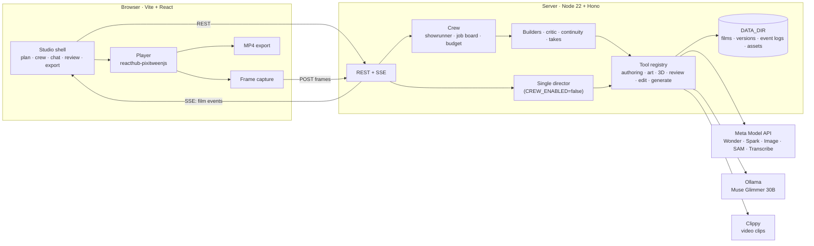
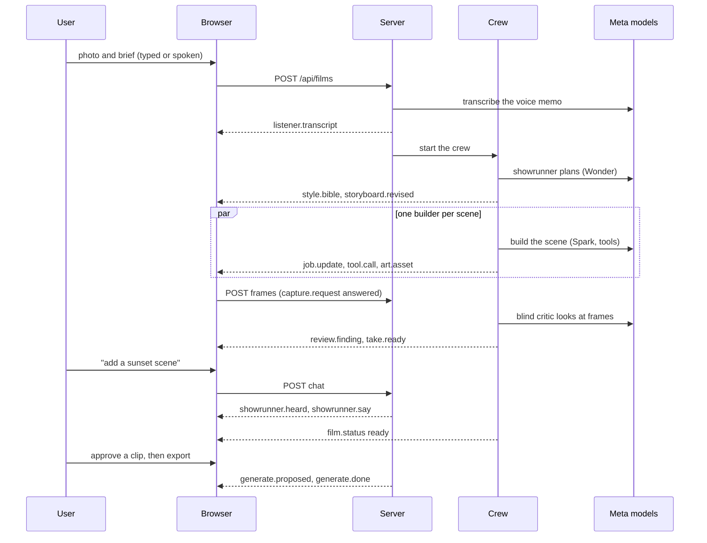

# Architecture

How PixiTween Director fits together. One Node process serves the API and the built web app. The film is JSON (a PixiJS timeline) that the browser plays live, so there is no render server; the browser also does the work only a browser can: capturing frames for the critic and encoding the MP4 export.

## System overview

| Part | Where | What it does |
|------|-------|--------------|
| Studio | `web/src/shell/`, `web/src/crew/`, `web/src/panels/` | the panels, the crew board and live map, the replay |
| Player | `web/src/player/Player.tsx` | plays the composition; says when every 3D layer has drawn |
| Capture and export | `web/src/capture/`, `web/src/export/` | frames for the critic; the MP4 |
| API | `server/http/` | REST routes, the event stream, rate limits, the film queue |
| Crew | `server/crew/` | the showrunner loop, the job board and scheduler, the budget, the workers |
| Single director | `server/agent/` | the sequential fallback: storyboard, scene builds, edits |
| Tools | `server/tools/`, `server/authoring/`, `server/art/`, `server/product3d/`, `server/review/`, `server/generate/` | everything that changes a film, each validated before it is saved |
| Stores | `server/store/`, `server/events/` | films with every version, event logs, assets |
| Model clients | `server/meta/`, `server/llm/`, `server/clippy/` | one client per outside service |

## Film lifecycle

The event names are the ones in `shared/events.ts`. Every one is appended to the film's event log, which is how a finished film can be replayed. The single director follows the same path with `director.storyboard` and `agent.turn` events in place of the crew's.

## Tools and the composition

A composition is JSON in the engine's own schema. Agents never write it directly: they call tools, and every tool call goes through a validator and commits a new version of the film (`tool.call` records it), so any step can be undone.

| Group | Tools | Notes |
|-------|-------|-------|
| Authoring | `addScene`, `addLayer`, `setTransform`, `setKeyframes`, `setCamera`, and others | pure functions over the composition; `server/authoring/` |
| Art | `generatePlate`, `placeProduct`, `addSubject`, `replacePlate` | Muse Image for plates, SAM 3.1 for cut-outs |
| 3D | `placeProduct3D`, `turnProduct`, `lightProduct` | only with `PRODUCT_3D=true`; a `model3d` layer wearing the photo's label |
| Review | `reviewScene`, `reviewDeterministic` | measured rules, then a model looking at frames |
| Edit | `scaleLayer`, `nudgeLayer`, and others | the chat edit tools |
| Generate | `proposeGenerate` | a clip, only after the user approves the price |
| Crew board | `reviseStoryboard`, `dispatch`, `cancel`, `finish`, and others | the only tools the showrunner has |

Scenes are precompositions, so a job that rebuilds one scene never touches another, and a cancelled job's scene is restored from a snapshot.

## Where Meta models are used

| Model | Id | Used for | Measured on 27 Oct (probes) | Price |
|-------|----|----------|-----------------------------|-------|
| Muse Wonder | `muse-wonder-1.0` | the showrunner | 5 of 5 parallel tool calls valid; about 22 s a turn on 30 Oct | about $0.06 a turn on 30 Oct |
| Muse Spark 1.3 | `muse-spark-1.3-contributor` | storyboard, scene builds, frame review, chat edits | 13 to 16 s for a planning turn; a whole scene of 6 parallel tool calls in about 18 s; 16 scenes at once all succeeded | $0.10 / $0.20 per 1M tokens in and out |
| Muse Image | `muse-image-1.0` | scene backgrounds and product shots | 12 to 22 s an image | $0.01 an image |
| SAM 3.1 | `sam-3.1` | product cut-outs and clip checks | 3 to 5 s an image; 240 video frames in 13 s | $2.50 per 1,000 images; $0.20 per 1,000 video frames |
| Muse Voice Transcribe | `muse-voice-transcribe-1.0` | the spoken brief | about 4.4 s a file | $0.18 an hour |
| Muse Glimmer 30B | `muse-glimmer:30b-mlx` | Local mode edits and review | 20 to 33 s a tool turn on an Apple M3 Max | $0 (your own hardware) |

Prices are from the vendor pages on 27 Oct 2026; latencies are from our own probes that day, listed in [`s1-evidence.md`](s1-evidence.md).
