# Architecture in a nutshell

How PixiTween Director fits together: the UI, the UI ↔ API contract, the backend and its outside services, and the
**Muse crew** that comes next. It describes the code on `integration` as of 29 Oct 2026. Anything planned but not
built yet is drawn with **dashed** borders and marked *planned*.

- [1. The big picture](#1-the-big-picture)
- [2. The UI](#2-the-ui)
- [3. UI ↔ API](#3-ui--api)
- [4. Sequences](#4-sequences)
- [5. The Muse crew (planned)](#5-the-muse-crew-planned)
- [6. Backend and infrastructure](#6-backend-and-infrastructure)
- [7. Not built yet](#7-not-built-yet)

Colour key used in every diagram:

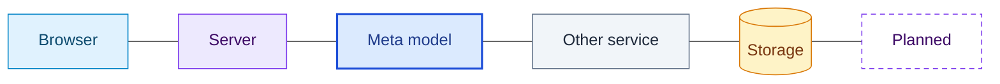

## 1. The big picture

One Node process serves both the API and the built web app. The film itself is JSON (a PixiJS timeline) that the
browser plays live, so there is no render server. The browser also does the work only a browser can: it captures
frames for the review and encodes the MP4 export. Every pixel of the film's art comes from a Meta model.

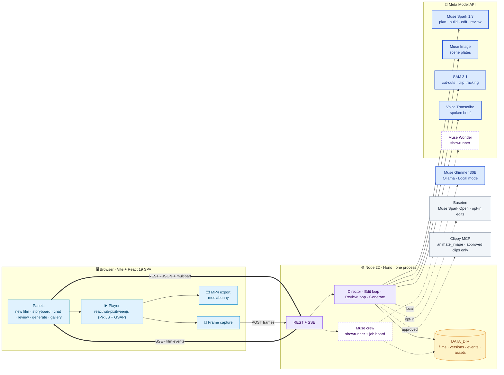

Rules that shape everything below:

- **Keys stay on the server.** `META_API_KEY`, `BASETEN_API_KEY` and `CLIPPY_TOKEN` are read only by `server/env.ts`.
  `npm run check:bundle` fails if a key name reaches the browser bundle.
- **The browser never edits a film directly.** Every change goes through the server (director, chat, undo, review,
  generate), which writes a new version and announces it on the event stream.
- **`shared/` is the contract.** zod schemas for the composition, storyboard, events and API bodies are imported by
  both sides, so a contract change fails typecheck on both.
- **The composition JSON is the single source of truth.** Agents never draw pixels; they call typed tools, and every
  write is validated before it is stored.

## 2. The UI

A single page (`web/src/App.tsx`). The film shown comes from the URL (`?film=<id>`); the Gallery changes it without a
reload. Every panel gets the same `{ film, events }` from one hook, `useFilm`, which loads the film and follows its
event stream.

**Today: the studio.**

```
┌──────────────────────────────────────────────────────────────────────────┐
│ PixiTween Director · Creative studio                     [film status]   │
├───────────────┬──────────────────────────────────────┬───────────────────┤
│ New film      │                                      │ Review            │
│ photo + brief │            Player                    │ findings · fixes  │
│ (or voice)    │   live PixiJS canvas of the film     │                   │
├───────────────┤   click a layer to select it         ├───────────────────┤
│ Storyboard    │                                      │ Chat  [badge]     │
│ scenes, shots │                                      │ "slower in        │
│               │                                      │  scene 2" · undo  │
├───────────────┴──────────────────────────────────────┼───────────────────┤
│ Generate: proposed clip, price, Approve              │ Export (MP4)      │
├──────────────────────────────────────────────────────┴───────────────────┤
│ Gallery: earlier films                                                   │
└──────────────────────────────────────────────────────────────────────────┘
```

**Planned: the crew studio** (shown for crew films; `web/src/crew/CrewStudio.tsx`).

```
┌──────────────────────────────────────────────────────────────────────────┐
│ PixiTween Director · Crew              💰 $0.41 of $1.50   [▶ Replay 2×] │
├────────────────┬─────────────────────────────────┬───────────────────────┤
│ LIVE STORYBOARD│                                 │ CREW                  │
│ ┌────────────┐ │                                 │ Showrunner · Wonder ⟳ │
│ │s1 hero  ✓  │ │           Player                │ Builder 1 · Spark  ✓  │
│ └────────────┘ │                                 │ Builder 2 · Spark  ⟳  │
│ ┌────────────┐ │                                 │ Builder 3 · Spark  ⟳  │
│ │s2 detail ⟳ │ │                                 │ Critic · blind     ⚑  │
│ └────────────┘ │                                 │ Continuity · rules ✓  │
│      ＋        │                                 │ Producer           💰 │
│ ┌────────────┐ │─────────────────────────────────├───────────────────────┤
│ │s5 sunset ✨│ │ TAKES  [A 6] [B 9 ★] [C 7] Pick │ DIRECTOR'S NOTES      │
│ └────────────┘ │                                 │ you: add a sunset…    │
│ ┌────────────┐ │                                 │ ▸ adding s5 after s2  │
│ │s3 pour  🎬 │ │                                 │ [🎙 hold to talk] [⏎] │
└────────────────┴─────────────────────────────────┴───────────────────────┘
```

The sketches show the panels, not exact sizes; the grid lives in the CSS. At 375 px the panels stack Player first.

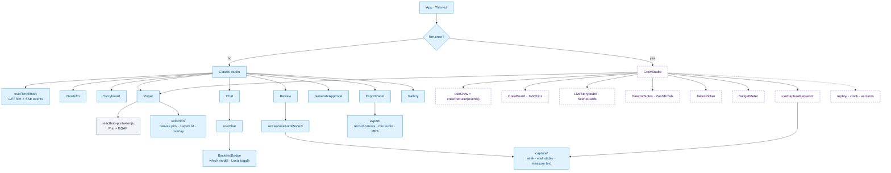

| Panel | Folder | What it does |
|---|---|---|
| New film | `web/src/panels/NewFilm.tsx` | Upload a product photo, type or record a brief, pick an aspect; `POST /api/films` |
| Storyboard | `web/src/panels/Storyboard.tsx` | Shows the director's plan as it arrives (`director.storyboard` event) |
| Player | `web/src/player/` | Plays the composition JSON with the engine; exposes a handle for capture and export |
| Selection | `web/src/selection/` | Click a layer on the canvas or in the layer list; the selection goes with the next chat message |
| Review | `web/src/panels/Review.tsx`, `web/src/review/` | Captures frames in the browser, posts them, shows findings and fixes |
| Chat | `web/src/panels/Chat.tsx` | Chat edits, undo/redo, and the badge naming the model that made each edit |
| Generate | `web/src/panels/GenerateApproval.tsx` | Shows a proposed video clip with its credit price; nothing is spent without Approve |
| Export | `web/src/panels/ExportPanel.tsx`, `web/src/export/` | Records the player canvas and encodes an MP4 in the browser |
| Gallery | `web/src/panels/Gallery.tsx` | Lists films; opening one sets `?film=` |
| *Crew studio (planned)* | `web/src/crew/` | Crew board, live storyboard, director's notes, takes, budget, push-to-talk, replay |

## 3. UI ↔ API

All routes live under `/api` and are registered from `server/http/routes.ts`; each feature owns one handler file in
`server/http/handlers/`. The passcode middleware (`server/http/auth.ts`, `DIRECTOR_PASSCODE`) guards the mutating
routes when a passcode is set. Rate limits and the film queue sit in the same middleware chain.

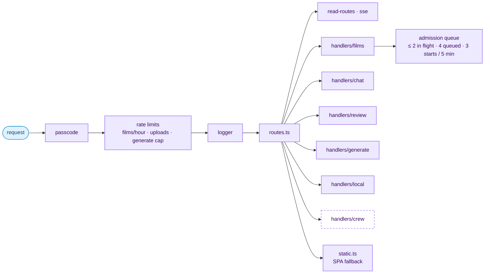

| Method | Path | Handler | Returns |
|---|---|---|---|
| GET | `/api/health` | `routes.ts` | Version, whether Meta is configured, ffmpeg, validator |
| GET | `/api/films` | `read-routes.ts` | Film list (Gallery) |
| POST | `/api/films` | `handlers/films.ts` | Multipart: photo + brief text or audio → `202 { filmId, queue }`, or `429` when the queue is full |
| GET | `/api/films/:id` | `read-routes.ts` | Film state: status, storyboard, composition, version |
| GET | `/api/films/:id/versions` | `read-routes.ts` | Version history |
| GET | `/api/films/:id/events` | `sse.ts` | **SSE** stream of film events (replays from the log, then live) |
| POST | `/api/films/:id/chat` | `handlers/chat.ts` | `{ message, selection?, local? }` → `202`; the edit runs in the background |
| POST | `/api/films/:id/undo` · `/redo` | `handlers/chat.ts` | `{ version }` |
| POST | `/api/films/:id/frames` | `handlers/review.ts` | Multipart frames + measured text boxes → starts the review |
| POST | `/api/films/:id/scenes/:sceneId/mode` | `handlers/generate.ts` | Switch a scene between motion and generated clip; proposes a clip with a price |
| POST | `/api/films/:id/scenes/:sceneId/approve` | `handlers/generate.ts` | Approval token → submits the paid clip |
| GET | `/api/assets/:id` | `read-routes.ts` | Image or clip bytes (unguessable 128-bit ids; Clippy also fetches stills here) |
| GET · PUT | `/api/local-mode` | `handlers/local.ts` | `{ local, reachable, … }`; turning it on checks Ollama and the Glimmer model first (`409` if missing) |
| GET | `/api/queue` · `/api/queue/:filmId` | film queue | Queue stats and a film's position (public) |
| *planned* | `/api/films/:id/crew` · `/log` · `/storyboard` · `/jobs/:jobId/cancel` · `/takes/:jobId/pick` · `/scenes/:sceneId/revert` · `/voice` | `handlers/crew.ts` | The crew board, the event log for replay, card edits, cancel, pick a take, revert a scene, spoken messages |

**Long work never blocks a request.** `POST /films`, `/chat` and `/frames` reply at once (`202`), and progress
arrives as events on the SSE stream. Every event is one of the types in `shared/events.ts`:

| Event | Meaning |
|---|---|
| `film.status` | `new → planning → building → reviewing → ready` (or `failed`) |
| `listener.transcript` | The spoken brief, transcribed |
| `director.storyboard` | The plan: scenes, shots, palette, title |
| `agent.turn` | One model turn: which backend, how long, how many tool calls |
| `tool.call` | One timeline edit (`version` set when it made a new version) |
| `art.asset` | A new scene image or cut-out layer |
| `review.finding` · `review.fix` | What the review found and what it changed |
| `generate.proposed` · `.progress` · `.done` | The paid-clip lifecycle |
| `cost` | Money spent, per model call |
| `error` | Where it failed and why |
| *planned* `crew.agent` · `job.update` · `showrunner.heard` · `showrunner.say` · `storyboard.revised` · `style.bible` · `take.ready` · `capture.request` · `budget` | The crew: who is doing what, every job transition, what the showrunner heard and said, storyboard revisions, takes, frame requests for the critic, spend against the cap |

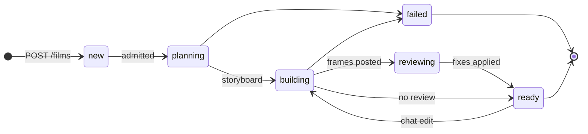

## 4. Sequences

### 4.1 Brief → playing film (today: one director, scenes in order)

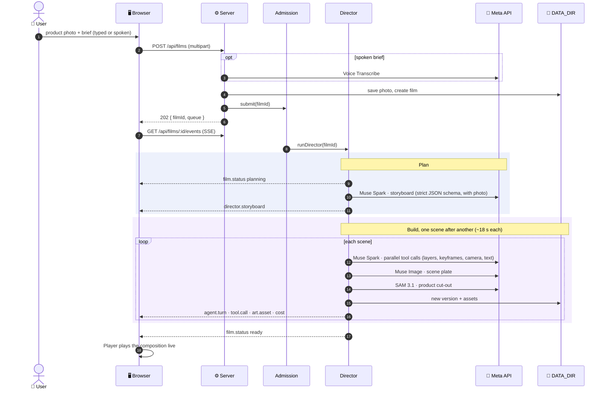

### 4.2 Self-review (the browser captures, the server judges)

The server can't run the engine, so the browser renders the frames and measures where the text actually landed.

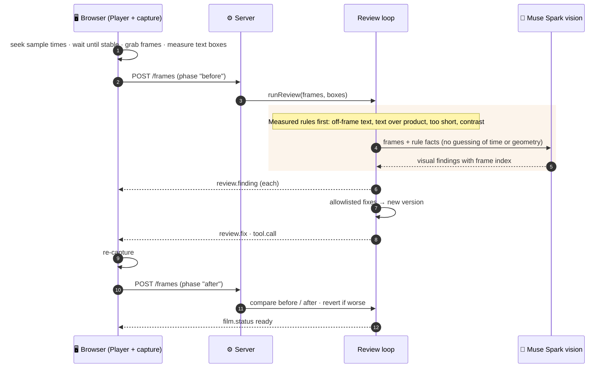

### 4.3 Chat edit

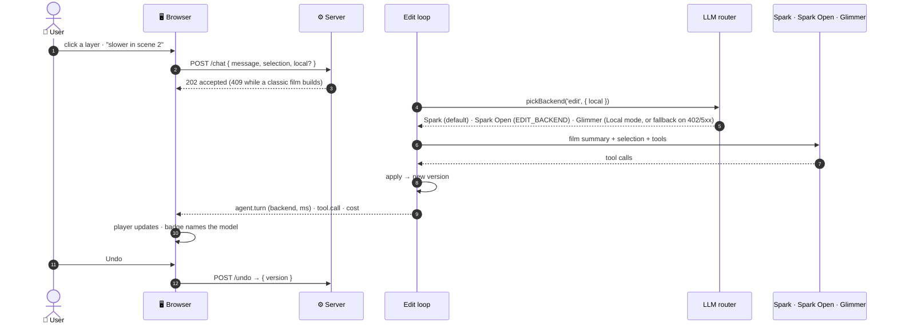

### 4.4 Generate mode (paid clip, approval-gated)

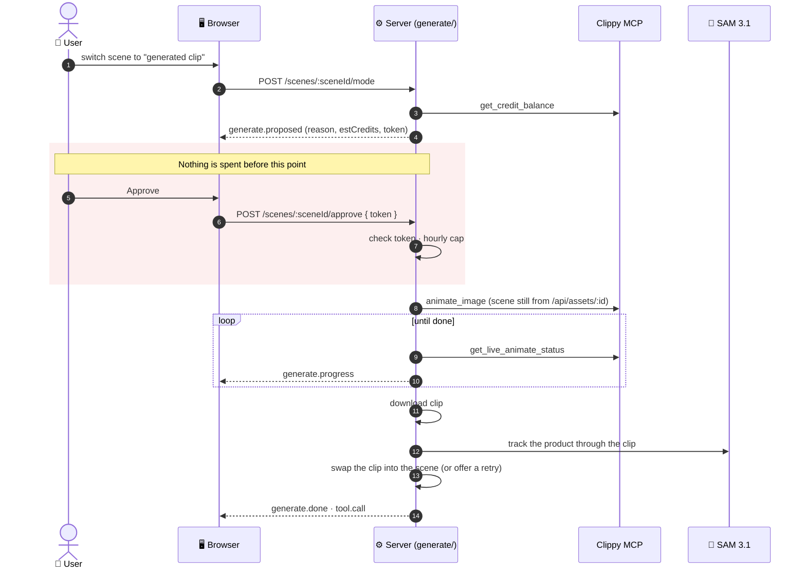

## 5. The Muse crew (planned)

The next build (S12). The single director becomes a crew: a **Muse Wonder showrunner** that you talk to the whole
time, and a job board that runs Spark workers in parallel. `CREW_ENABLED=false` keeps the director of §4.1.

### 5.1 Who does what

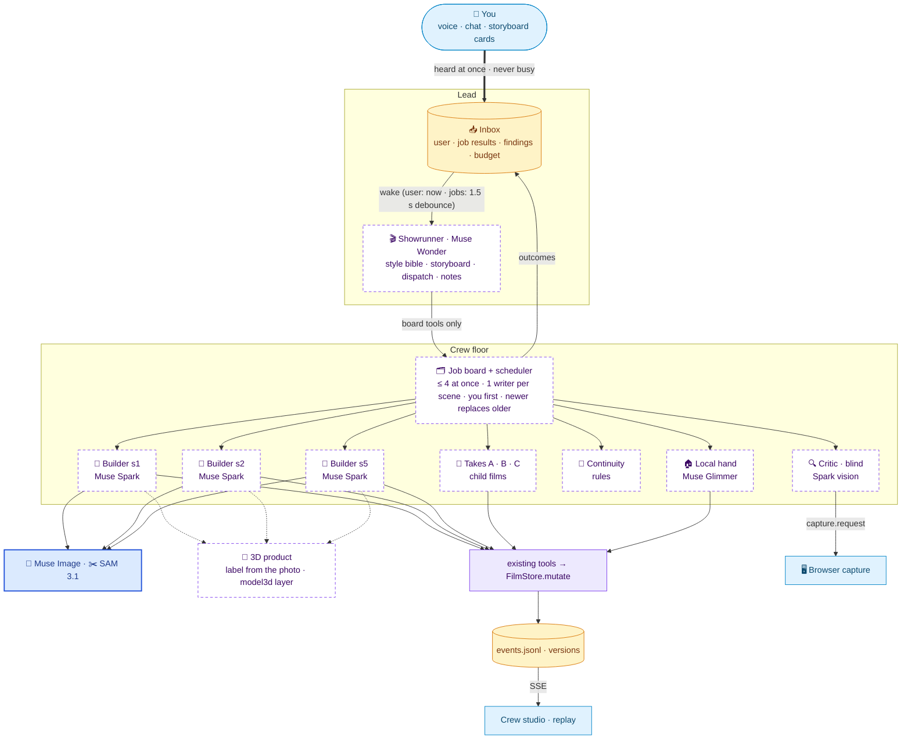

### 5.2 Directing mid-build

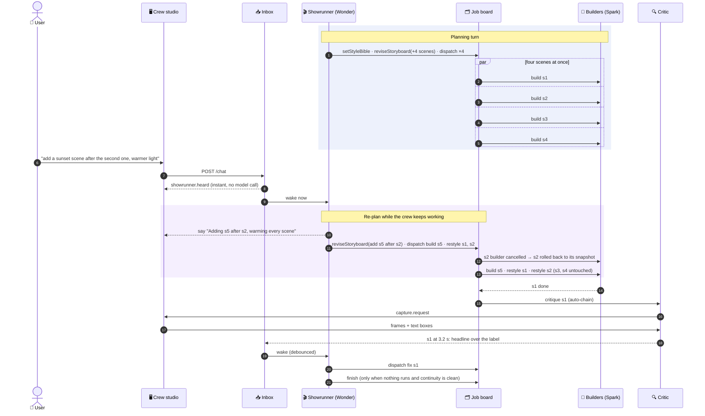

### 5.3 A job's life

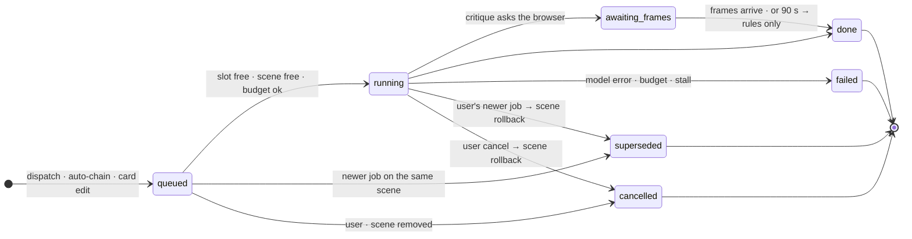

## 6. Backend and infrastructure

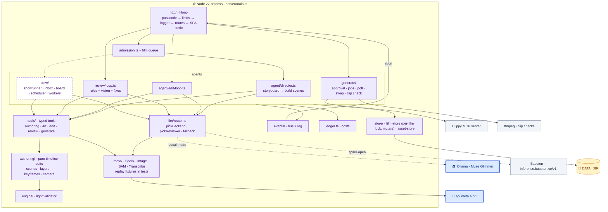

### Storage: plain files under `DATA_DIR` (default `./data`)

```
data/
├── films/<filmId>/
│   ├── film.json         current state: status, storyboard, head version, redo stack
│   ├── versions/<n>.json one composition per version (undo/redo moves the head)
│   ├── events.jsonl      every event, replayed to late SSE subscribers (and, planned, to the gallery replay)
│   ├── ledger.jsonl      every model call and its cost
│   └── crew/             planned: board.json (jobs) · snapshots/<jobId>.json (scene rollbacks)
└── assets/
    ├── <assetId>.json    metadata (mime, size, role)
    └── <assetId>.<ext>   bytes: product photo, scene images, cut-outs, clips
```

No database. Writes are atomic per file and serialised per film. Because state lives on disk, the server must run as
**one long-lived process with a persistent volume**: it can't run on serverless functions as it is.

### Outside services

| Service | Used for | Key | When |
|---|---|---|---|
| Meta API (`api.meta.ai/v1`) | Muse Spark (plan, build, edit, review), Muse Image, SAM 3.1, Transcribe; *planned:* Muse Wonder (showrunner) | `META_API_KEY` | Every film |
| Ollama (local) | Muse Glimmer for Local mode, and fallback when Meta returns 402/5xx | none | When Local mode is on, or as fallback |
| Baseten (`inference.baseten.co/v1`) | Muse Spark Open for chat edits | `BASETEN_API_KEY` | Only with `EDIT_BACKEND=spark-open` |
| Clippy MCP | One generated video clip per approved scene | `CLIPPY_TOKEN`, `CLIPPY_MCP_URL` | Only after Approve |
| npm `reacthub-pixitweenjs` | The player engine, in the browser | none | Always |

### Limits and safety

- **Admission:** at most `FILMS_IN_FLIGHT_MAX` films run at once, `FILMS_QUEUE_MAX` wait, and at most
  `FILMS_STARTS_PER_WINDOW` start per `FILMS_WINDOW_SEC`; beyond that `POST /films` returns `429` with `Retry-After`.
  Planned for the crew: 2 starts per window (a crew film uses about 60 of Meta's 150 requests per window).
- **Spend:** every model call is written to the ledger and sent as a `cost` event. Paid clips need an approval token
  and are capped per hour (`GENERATE_MAX_PER_HOUR`). Planned: a per-film crew budget with warn at 80 % and stop at 100 %.
- **Tests never call real services:** the Meta clients replay recorded fixtures, and Clippy and the LLM have fakes.
  Real calls happen only in `npm run live -- <step> --yes`, run by the owner.

### Running it

| | Command | What runs |
|---|---|---|
| Dev | `npm run dev` | `tsx watch server/main.ts` (port 8787) + Vite dev server |
| Prod | `npm run build`, then `node` on `server/main.ts` via tsx | Hono serves the API and the built SPA from one port |
| Checks | `npm test` · `npm run e2e` · `npm run typecheck` · `npm run check:bundle` | Vitest, Playwright, tsc, key-leak guard |

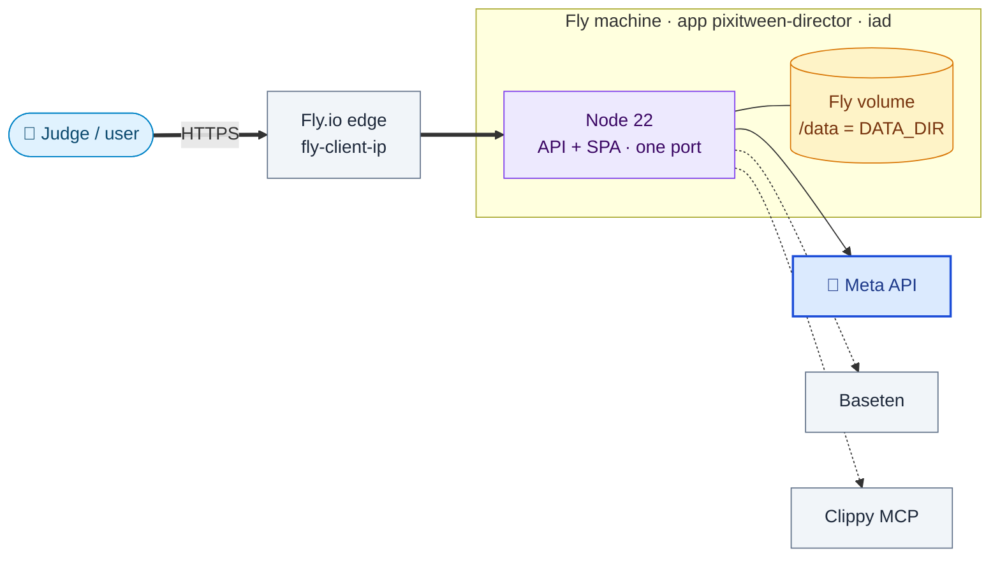

## 7. Not built yet

| Piece | State |
|---|---|
| Deployment (S8b) | `Dockerfile` and `fly.toml` (volume at `/data`) are written; not deployed yet. Local mode is not available on the host (no Ollama there). |
| Engine multi-scene playback | Fixed in `reacthub-pixitweenjs@0.3.0-alpha.4`, confirmed on `0.3.0-alpha.5` (2026-10-30): playing through a scene boundary and seeking to a scene with a clip layer both work (`ENGINE-NEEDS.md`). |
| Frame review on Spark Open | Review always uses Meta Spark (or Glimmer in Local mode). |
| Parallel scene building | Scenes are built one at a time; the crew's scheduler replaces this. |
| MCP server for the director (S11) | Planned; the boot-hook slot in `server/boot.ts` is reserved for it. |
| **3D product shots (S13)** | Engine side done; app side planned. The engine now has a `model3d` layer (shipped in `0.3.0-alpha.5`): one shared Three.js renderer drawing into Pixi textures, frame-driven, inside scene precomps, so capture and export see it. The Director adds `server/product3d/` (label unwrap from the photo, box faces, extruded contours), the tools `placeProduct3D` / `turnProduct` / `lightProduct`, and the three-way Motion / 3D / Generate decision. Behind `PRODUCT_3D`. |
| **The Muse crew (S12)** | Planned, the next build (§5). A Muse Wonder showrunner (`server/crew/showrunner.ts`) reacts to an inbox and acts only through board tools; a per-film job board and scheduler (`server/crew/scheduler.ts`) run Spark builders, a blind critic, continuity checks and takes (child films); chat to a crew film never returns 409; the web app gets a crew studio (`web/src/crew/`) and a replay of any film's event log. `CREW_ENABLED=false` keeps today's director. |
